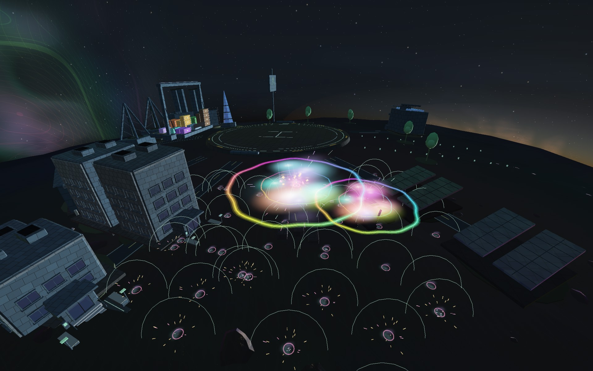
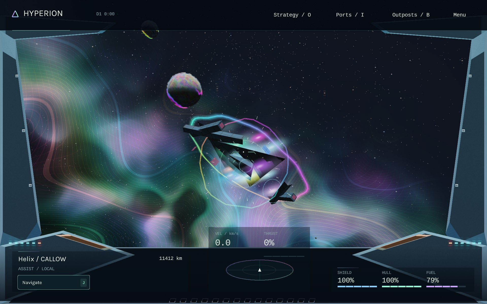
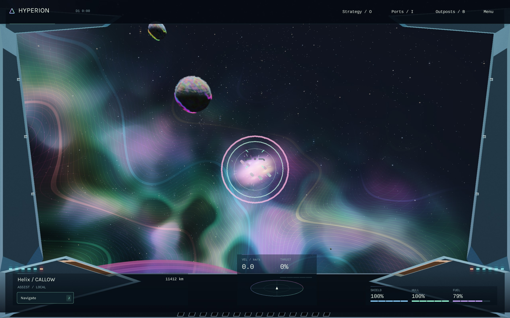
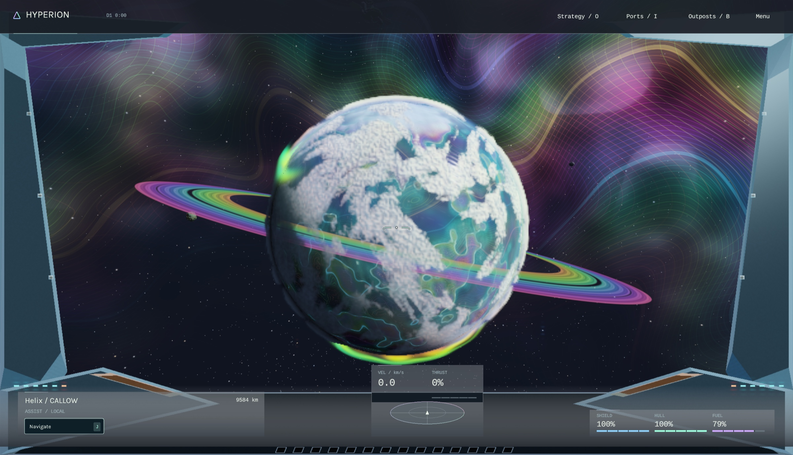
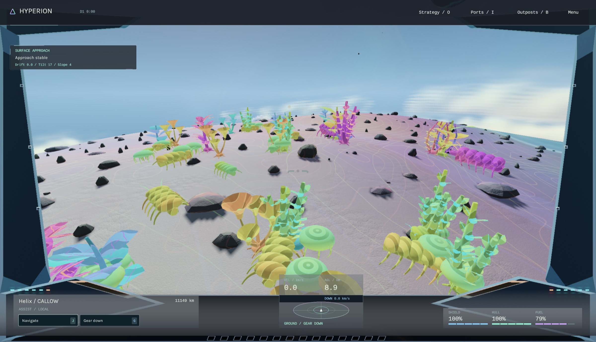
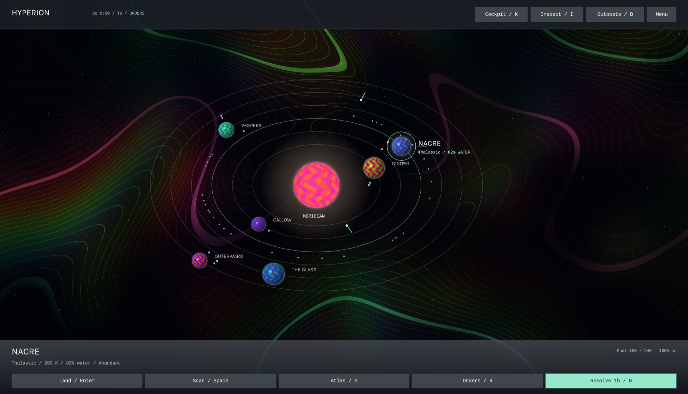

# HYPERION 3.59

A native C++17 space exploration and strategy game with Elite-style cockpit
flight, a procedural universe, living ecosystems, outposts, factions and a
connected economy. Iridescent planets, spectral nebulae and psychedelic surfaces
run in the native renderer.

There is one ship, one cargo hold, one account, one simulation clock and one save.
Cockpit flight runs in real time; every other gameplay mode is turn based.

## Destructible universe in 3.59

Weapons, explosive splash and physical collisions can damage settlement
facilities, station cores and solar wings, loading equipment, containers,
beacons, planted vegetation, native organisms and surface rocks. Asteroids and
comets fracture into debris with finite ore, crystal and fuel salvage. Ship
wrecks can also be destroyed. Planets and moons receive local impact scars;
planetary impacts deform the nearby collision and terrain surface.

Damage belongs to the campaign. Returning to a system or loading a save retains
ruins, missing objects and remaining salvage. Facility integrity reduces actual
production, power, housing, storage and services. Reactor and fuel-plant losses
can chain through neighboring objects and pollute the habitat; habitat losses
cost lives and morale. Destroyed containers remove real warehouse goods.
Killed organisms return their existing biomass to the ecosystem's detritus.
Destroying a pirate anchorage removes its supplies and increases surviving
crews' vendettas. Civilian infrastructure attacks incur restitution and standing
losses. Firing near a port forfeits its protection from hostile fire.

At an owned settlement, **Construction** rebuilds a damaged facility in its
original lot. **Demolish one** removes a standing facility. **Operations →
Rebuild port equipment** restores a berth first, then other equipment, using
ship materials and credits. NPC settlements attempt funded reconstruction every
six hours. Freight holds when both destination berths are destroyed.

On a surface expedition or underwater, open **Dismantle object** in the contact
details. Close-range cutting takes one turn, one component and 20 battery,
and loses the object's remaining supplies and evidence. Natural geological
vents remain part of the planet; rescue a wreck's crew before dismantling its
hull. Study and collection remain separate choices.

Low graphics and Reduced effects use the same destruction state with smaller
debris budgets. Older campaigns load with intact scenery until it is damaged.
`hyperion_world_destruction_tests` exercises collision, economy, law, ecology,
reconstruction, finite salvage, malformed saves and turn-based dismantling.
The optional native `hyperion_world_destruction_check` target renders 18
scenarios, including saved ruins, reconstruction and moon impacts.



*Reactor damage cascades through real neighboring objects; the ruins persist.*

## Ship destruction in 3.58

Destroyed ships now separate into pieces of their **actual procedural hull**.
Wings, nose, engine sections and core retain faction materials and hull variants,
tumble around their own centres and remain as the salvage wreck. Existing saved
wrecks recover their appearance from the associated vessel where available.
Salvage contents, rewards and faction consequences retain their existing rules.

Explosions combine rippling rainbow shock fronts in space, curling fire
filaments, staggered engine and reactor bursts, cooling embers and softer smoke.
The weapon and vessel seed influence the colour and fire pattern. Damaged ships
vent smoke and energy before destruction. Optional sound adds layered secondary
failures beneath the initial blast. Reduced effects and Low graphics retain the
same sequence with fewer filaments, plumes and shock-wave layers.

`--destruction-check --captures DIRECTORY` checks seven disposable scenes:
five faction hulls, six simultaneous losses, and an older restored wreck.
Fracture construction checks that every source triangle is retained. Visual
wreck metadata is reconstructed without changing the campaign save format.



*The ship’s own hull becomes its wreck, captured in the native renderer.*

## Combat feedback in 3.57

Weapons have distinct muzzle flares, spectral trails, brief cockpit illumination
and restrained cabin recoil. Shield hits spread across the contact plane; a
shield break scatters prismatic fragments. Penetrating hits show armour sparks
as well as the shield ripple. Destruction unfolds through a short hot core,
expanding spectral shock fronts, cooling fire, debris and smoke.

The minimal HUD briefly confirms shield hits in cyan, hull hits in amber,
shield breaks in violet and destruction in mint. Incoming damage stays
directional at the canopy edge. The aiming camera remains steady. Reduced
effects removes cabin kick and reduces flashes and particles; Low graphics
also lowers the effect detail. Existing weapon balance, damage, loot, faction
consequences and save formats are unchanged.

Sound (**F10**) adds layered energy pulses, percussive kinetic fire, bass-heavy
plasma, seeker exhaust, harmonic resonance and separate shield, hull and break
sounds. Independent sound playheads preserve rapid-fire tails. Sound remains
optional. `--combat-feedback-check --captures DIRECTORY` runs eleven disposable
native scenes, including a silent audio playback and lifetime check.



*An enemy ship breaks apart in the native combat renderer.*

## Graphics in 3.56

The Graphics Lab upgrade is now the full game's default **High** graphics mode:
sharper planet materials, denser clouds, larger shadow and detail maps, richer
atmospheric lighting and spectral nebulae. **Settings → Graphics: Low** restores
the previous lighting, cloud sampling, texture sizes and 1080p scene limit.
Both modes keep the smoother life streaming and blended anatomy transitions.
Your graphics choice is remembered separately from your expedition save and can
be changed while playing. `--graphics high|low` selects a mode for one launch.
The existing reduced-effects option remains independent.



*Rainbow rings, cloud banks and spectral nebulae, captured in the native renderer.*



*Surface approach from the ship's cockpit, above sunlit terrain and procedural alien life.*



*Plan exploration and resolve orders in the turn-based system view. All three images are actual Hyperion gameplay captures.*

## Wreck expeditions in 3.55

Ocean sectors now contain persistent survey tenders with real faction ownership,
settlement histories, finite cargo and stranded crew. A newly located missing
shipment is debited from its settlement's supply reserves and faction crew pool;
returning to the same sector cannot create another cache. R lists nearby wrecks
alongside the existing survey sites. Choose one, approach, resolve its signature
and Study the hull. Entry and recovery require a closer 80-unit approach.

Enter rescues up to two survivors per hour, consuming one medicine and ten power.
Six rescue seats are shared across all wrecks. C quietly recovers up to six units
of the selected cargo for eight power. I opens Details to select another finite
cargo type. X cuts up to sixteen units for eighteen power and 1.2 hull, after the
crew are clear; cutting alarms fauna and physically disturbs the local food web.
Living biomass becomes detritus, and habitat quality and pollution change. Shared
fishing and growing habitats use those same populations and ecological services.
All work consumes turns; no crew or cargo are collected by a sonar ping.

Current arrows use the same procedural flow field as movement. Headwinds consume
extra power; vent plumes cause previewed hull exposure. Clear water and shelter
near the floor offer alternative routes. Details compares direct and sheltered
approaches with approximate time, power and hull costs. Plotting either is free;
estimates exclude work, recharge, floor obstructions and other interruptions.

Rescued passengers and recovered goods remain aboard after surfacing. Physically
dock at the owning settlement and unload: survivors join its population and the
supplies enter its warehouse. Recovery commissions use existing acceptance,
escrow, deadlines and debriefs; pay comes from the issuer's treasury. Crew left
inside have a visible life-support deadline that runs on simulation hours.
Partial salvage, missing crew, passengers, deliveries, habitat damage and funded
missions persist in saves. Existing saves gain the optional wreck collection only
when a new ocean sector is visited. Listening or active sonar also locates new
sectors during an ongoing dive; repeated pings preserve the original cache. The underwater chart remains a single view,
with its small action dock and optional details drawer.

`--wreck-check` exercises the complete native select, Study, rescue, salvage,
cutting, return, unload and funded debrief sequence.

## A quieter, deeper dive in 3.54

The underwater screen now gives the chart almost the whole window. One slim
header shows the objective, depth, power and estimated moves home; hull appears
when damaged. A small bottom dock holds the actual next action, optional sample,
return and Sites. The large objective box, progress strip and generic inventory
footer have been removed. R opens a compact Sites / Contacts / Details drawer;
selecting a site closes it. I opens Details for ecology, repair and sonar options.

After Study, Enter can freely select a nearby resolved, unstudied contact so a
sortie can continue without menu work. It only replans: further movement and Study
still consume their own turns. Damaged hulls and full holds suppress suggestions.
K deliberately commits to the return route, after which Enter continues home.
C remains a separate optional sample, using real biomass or finite mineral stock.
Manual waypoints still take priority and pressure danger still requires ascent.

Shift+Space listens quietly for one hour and two power, resolving life, vents
and signals at shorter range. Space spends twelve power for wider active sonar,
including minerals, and temporarily startles nearby wildlife. The alarm decays
with committed hours; rendering cannot run down its timer. Sonar never archives
research or takes goods. Existing reactor recharge applies to both choices.
The animated sonar pulse uses the selected method's actual range. Quiet listening
does not reveal silent mineral formations. Details explains these tradeoffs and
shows the selected living site's real population report.

Shallow dives keep the surface near the top of the chart, showing more water.
Spectral currents, bioluminescent fauna, seafloor and the launch buoy remain visible.
Planning, camera movement and drawer navigation remain free; all work and travel
resolve turns. Existing campaign saves retain their exact format.
`--ocean-survey-check` now exercises fifteen native scenarios, including quiet
listening, free continuation, deliberate sampling and physical buoy recovery.

## Clearer dive decisions and recovery in 3.53

Enter now performs the next labelled dive action: approach, sonar, Study, one
normal return step, or recovery. Collection remains a separate deliberate
choice. Low scanner or study battery offers a recharge with its actual duration;
deadlines and pressure still constrain automatic work. K remains the faster,
bounded return shortcut. Movement and ordinary work cost one hour per press.

Dive operations adds a list of the six nearest resolved sonar contacts. Selecting
one is free, plots the actual contact and returns the panel to its primary action.
The three suggested survey sites compare biology, geology and signal work,
pressure-shell usage, approximate moves to study range and moves home from the
site. These estimates exclude work, recharge and event interruptions.

A recovered dive now gives a compact results card and an expandable debrief:
actual distinct Study actions, optional collections, deployment-to-recovery time,
hull change and net cargo already in the shared hold. You can study several sites
in one dive; samples, minerals and research keep their existing ecological and
economic effects. There is no additional completion payout. Detailed debriefs
are session records, cleared by a new dive; catalogue evidence and completed
survey markers retain the existing save format.

The chart uses fewer repeated biology labels, a smaller objective card while the
operations panel is open, and a bearing to an offscreen launch buoy. Spectral
currents and living creatures remain. `--ocean-survey-check --captures DIRECTORY`
exercises thirteen native scenarios, including contextual keyboard orders,
sonar selection, optional collection and the recovery debrief.

## Underwater: turn-based submersible surveys in 3.52

Underwater play is a side-on sonar-chart expedition: locate a real generated
survey site, ping sonar, Study it, optionally Collect, then return to the launch
buoy and recover. The selected objective gives each dive a direction. R opens the compact dive drawer; choosing another biological,
mineral/vent or ancient-signal site is free. Sites respect the actual generated
seafloor and current pressure certification. Research, specimens and minerals use
the existing cargo, ecology, missions and economy; there is no invented payout.

Sonar costs 12 battery and one hour and only reveals signatures. It no longer
automatically catalogues contacts or takes resources underwater. Nearby visual
contacts remain visible. Study and Collect are explicit choices. The quieter
chart retains spectral currents and moving life while separating the launch buoy,
course, sonar envelope, seafloor, depth guides and pressure limit.

Enter advances the course by one hour; arrows steer individual turns. Space
pings sonar. E ascends one step until 80 m or less, then recovers the submersible.
K follows up to six physical return steps toward the buoy. At the buoy within
recovery depth, Enter or E recovers the submersible.
Recovery and orbital launch require a physical ascent; deep dives cannot jump
straight into the cockpit. Emergency hull-breach recovery still works. The
return route can stop for risks, discoveries and deadlines, as elsewhere.

Recovering a recorded objective at its launch buoy records a completed survey;
samples and research already occupy the shared hold. Surfacing elsewhere keeps
the evidence and ends the transect. Detailed operations and unrecorded sonar
returns last for the session; discoveries and completed-survey markers persist
in the existing catalogue without changing the campaign format.

`--ocean-survey-check --captures DIRECTORY --windowed` exercises the actual
native controls for site selection, sonar, study, bounded return, recovery,
pressure ascent and sonar recharge. The ocean CPU suite checks genuine seeded
sites, clock and cargo conservation, manual courses, deadlines and save records.

## Connected strategy and flight in 3.51

K now switches both ways: take the helm from strategy, then return to planning
with K or O. The return restores your previous galaxy/system chart, selection,
camera and panels while retaining the physical ship, manual helm and targets.
Returning after a system change opens the current system instead of a stale chart.
Mode changes wait for held controls to be released before gameplay resumes.

Boarding remembers the expedition's plotted route. Redeploying at the same
physical landing site restores surface waypoints. Recovering a submersible still
costs one turn; after redeployment, Dive can restore its ocean target without
teleporting back to the old depth. Landing somewhere else starts a fresh route.
This recall lasts for the session and does not change the save format.

Next moves adds Approach for distant contacts: travel normally for up to six
turns, stopping within study range, for new discoveries, risks or deadlines.
Recharge waits only until the scanner has 12 battery, stopping for important
events and before an accepted deadline. Both use actual shared simulation time.
Transfer tooltips show recovery/deployment costs; the mode handoff explains
whether the world is frozen or real time is resuming.

## More to do each turn in 3.50

R now opens Next moves: contextual field choices, current objectives, nearby
commissions and outposts that need attention. Time/forecast remains available
as a separate disclosure. Strategic ship orders (Hold, Engage, Evade) are close
at hand while the world is paused. N resolves an hour of the shared simulation.

A focused Study costs 6 battery and one hour, awards extra research, and leaves
specimens and material caches intact. Collect is a separate 10-battery,
one-hour choice after studying. Samples remove real living biomass above the
population's reserve; ore and crystals come from finite site allowances.
Quotes show what fits in the hold. Repeating or reloading cannot replenish a
collected site. Earlier standard scans retain their original collection rules
and cannot be collected again through the new controls. Survey markers persist
in the existing catalogue, keeping the campaign format compatible.

Normal travel recharges the scanner as before. Push covers 1.8 times the normal
stride for 8 battery and a displayed amount of hull wear based on terrain,
weather or depth. Field patches recover up to 8 hull for 2 alloy, 1 component,
8 battery and an hour. These supplies share the hold used by building, trade,
missions and settlement production.

Shift+Enter follows a plotted surface or dive route for up to six turns. It
stops at the waypoint, new signals or relics, damage, important economic events,
new colony crises or impending deadlines. It refuses unsafe automatic dives.
The remaining waypoint stays plotted after a stop; Enter still takes one
normal step. All intervening turns advance the same ecosystems, factions,
freight and populations. Planning itself remains free and frozen.

## Turn planning in 3.49

R opens a compact turn planner in the Inspect panel. Choose 1, 3, 6, 12 or 24
hours, review battery recovery and risks, then commit a wait. The upcoming
24-hour timeline lists accepted mission and delivery deadlines, player-related
freight arrivals and estimated civic research completion. Settlement entries
open their actual outpost. Research estimates use current lab output and can
change with food, power and weather.

Next event waits at most one day. Long waits return control after the next full
hour when relevant freight arrives or is held at a full warehouse, research
finishes, the navigator docks, a new armed contact enters range, or an existing
crisis/mission/damage interrupt occurs. Existing known alerts and held shipments
do not repeatedly cancel another explicit wait. Waypoints survive waiting, so
recharging no longer erases a planned surface or dive route.

The latest 12 resolutions can be reviewed during this session, including actual
campaign-hour intervals, resource changes, outpost bottlenecks and why a wait
stopped early. Committing from the planner opens its report automatically. R
returns to planning; N remains one hour and Shift+N waits up to six. Reports are
session information; the campaign save format stays compatible. The world stays
frozen until you commit an order, and cockpit flight retains real time.

## Minimal flight HUD in 3.48

The windscreen now stays open: duplicate speed/altitude tapes, the compass plaque,
mode captions and navigation card have been removed. A slimmer lower rail carries
navigation, speed, clearance, shield, hull and fuel once. Weapon details appear
when a target is selected, weapons are heating or charge is depleted. Full combat
and ship details remain available in the side panel.

F8 toggles optional flight guidance. This now adds small bearing and velocity
marks, a two-stroke horizon during close surface flight, a manual braking warning
only when needed, and a compact unboxed combat target label. A settled cruise
has no extra instrument panels around the aiming mark. The restrained mint,
cyan and violet accents preserve the psychedelic world outside the canopy.

The choice remains in Menu and Settings and is remembered outside the campaign
save. F9 hides/restores the interface. Switching guidance does not issue orders,
change thrust or advance a strategic turn. Existing display preferences remain
compatible; `--hud enhanced` selects the simplified guidance for a run, while
`--hud minimal` disables it. `--hud-check` exercises drift, landing, combat,
small windows, menus, settings, hiding/restoring and strategy transitions.

## Close materials in 3.46

Planet ground now layers small mineral inclusions and granular relief over its
larger geology, with secondary wind ripples, porous frost, basalt chips and salt
crystals. Orbital geology retains finer seeded mineral grains. Moons gain crater
wall terraces and radial ejecta; asteroids gain breccia and rough dust. Close
minor-body surfaces also use locally anchored grains beyond their spherical
texture resolution. Rock and frost keep broad, matte light responses.

Buildings have finer brushed alloy, coating grain, porous aggregate and small
abrasive pits. Enemies and other ships now use panels at their actual hull scale,
with seeded finishes, thermal discolouration, engine deposits and exposed armour
that follows current hull condition. Ports reset the shared shader state before
drawing, keeping their separate material scale. Spectral pigments and inlays
remain visible throughout the material layers.

All fields are mipmapped and small detail fades with pixel footprint. Ground
grain reuses packed channels; enlarged relief texels receive extra smoothing
only when needed. The limit of two close minor-body fields is unchanged; extra
local detail reuses the existing ground atlas. `--close-material-check` captures eight close building
views, five generated faction hulls and three close minor-body surfaces with a
frozen simulation; `--close-material-benchmark 0..15` measures the same poses.

## Surface materials in 3.45

Moons, asteroids and comet nuclei now have seeded material fields with excavated
crater floors, raised ejecta, broken regolith, mineral bands, fractures and frost.
The fields follow the generated crater geometry. Matte rock and granular ice use
relief normals, roughness and cavity shading, keeping spectral mineral colour.

Close bodies blend into 2048 x 1024 material fields. At most two high resolution
fields are resident; smaller bodies use filtered base fields, with hysteresis and
smooth detail transitions. Material baking happens before the flight render pass,
and colour, cloud occlusion and weapon collision retain the same body geometry.
Solid planets use 1536 x 768 geological fields, with finer strata and grit; the
close ground material field is now 1024 x 1024. These are visual changes only.

## Smaller bodies in 3.44

Each system now has deterministic minor bodies: every recorded planetary moon,
one or two debris belts containing individual asteroids, and one to three comets.
Moons orbit their actual parents. Inclined, eccentric Kepler orbits use the shared
simulation clock and remain frozen while planning strategic turns. Existing
planets, settlements and traffic home indices retain their identities.

Cratered moons, irregular rocks, frosted nuclei and spectral comet tails appear
in flight. Matte regolith, ice and mineral bands retain the psychedelic palette.
The system chart shows selectable bodies; Enter plots the selected fly-by.
I > Bodies filters cockpit destinations.
J routes to a safe stand-off point. A survey within 600 km below 20 km/s consumes
6 scanner battery and archives the body, with research data using the actual hold.
Each body can be surveyed once. Minor bodies block ships and weapon fire; routes
include their conservative bounds. They have no docking or expedition facilities.

The catalogue regenerates from the existing universe seed, including in older
campaigns. Saved survey records and fly-by targets keep stable identities.
`--minor-body-check --captures DIRECTORY` exercises seven native chart and flight
views; `--minor-body-shot 0..6` selects an individual no-save view.

## Screen fit in 3.43

The app fits windowed mode inside the current display's usable area, including
window borders, the menu bar and Dock. Returning from fullscreen or changing
displays refits the window. Smaller windows use a uniform UI scale; drawing,
pointer hit tests, charts and cockpit markers share the same logical coordinates.
The minimum native window is now 720 x 450, with the full layout fitted inside it.

Cockpit instruments have a proportional inset from the bottom and side edges.
The psychedelic world and existing minimal instrument design are retained.

## Minimal cockpit in 3.42

Velocity, ground altitude, vertical speed and stopping distance now sit together
above the contact scope, leaving the middle of the windscreen clear. The lower
navigation and systems deck is shorter. Landing guidance gives the current phase,
action and ground alignment without repeating the main flight readings.

The compact side-panel layout keeps weapon charge, heat, ammunition and focus in
one place. Quiet glass edges carry fine cyan-to-violet inlays, and the radar has
a restrained spectral orbit. These accents are static and add no bloom or render
passes. Critical warnings retain their own colours and text. World labels leave the
aiming reticle and lower instruments clear.

Location is a single context rail. Unaccepted mission offers stay on the mission
board unless explicitly tracked. Active missions and plotted objectives remain
visible. The existing shortcuts, simulation, world graphics and saves are retained.

## Cockpit instruments in 3.41

The cockpit has a recessed glass instrument deck with grouped navigation,
contextual action keys, a contact or landing scope, and larger shield, hull and
fuel gauges. Restrained mint, ice blue and violet accents echo the psychedelic
world without washing out the view. Velocity and ground altitude have larger
readings; stopping distance, drift and climb or sink remain close to the reticle.

Landing and departure use a clear three-column approach card. Commission,
weather and combat information has dark backing for bright skies. Contact
brackets, lead diamonds, charge indicators and selected radar contacts share the
same visual language. The deck compresses when a side panel is open. Existing
controls, game rules, simulation, saves and world graphics are unchanged.

## Procedural operations in 3.40

Open **B**, then **Missions** at the top of Outposts or Market. Jobs are generated
from actual settlement reserves, economic shipments, pirate captain registries
and planetary features. World seed, issuer, current conditions and six-hour shift
choose the type, target, location, cause, risk, title, reward and deadline. Quotes
refresh as the simulation advances. There is no fixed quest sequence.

- **Relief:** deliver the generated quantity of the commodity a settlement lacks.
  Partial deliveries enter its real warehouse, affecting prices and production.
- **Escort:** protect a specific real freight trip. Stay within 650 km, with clear
  line of sight, for at least 45% of the leg remaining when you accept. Its actual
  cargo must arrive; losing more than 35% fails the commission. Plot tracks its
  visible freighter. Docked, remote or frozen time cannot earn escort coverage.
- **Interdiction:** defeat a specific existing pirate captain. Another combatant's
  kill fails the objective. Existing bounties, feuds and faction consequences apply.
- **Field research:** catalogue a real generated feature, from mineral seams and
  life to signals and relics. Plot gives the flight marker; after deploying on the
  correct world, Plot sets the expedition waypoint. Bring the requested research
  data back: it transfers into the issuer's real stores.

Accepting reserves the quoted reward from the issuer's treasury. Complete the
physical objective, then **return to the issuer and Debrief** for payment and
standing. Six commissions can be active. Deadlines, partial deliveries, escrow,
escort coverage and objective stages persist in saves. Abort or failure returns
unused escrow and reduces issuer trust. Accepted jobs and their deadlines freeze
outside the cockpit until an order advances time. Successful mission orders cost
one strategic hour; plotting and reading the board are free.

The same seeded, moving storm fronts now affect settlement daylight, clouds and
low-altitude flight. Gusts apply bounded forces which flight assist compensates
within the actual thruster budget. Airless worlds have no storms. Storm clouds
have deeper volume, soft spectral discharges and occasional lightning; reduced
effects disables lightning glow and bolts. The cockpit shows local storm severity.

Shield absorption and hull penetration have distinct directional colours and
impact readouts; penetrating hits identify the damaged component. Enemy details
show charging, withdrawal, venting and workshop intent. Impact rings retain the
spectral palette. Mission tracking stays compact in the cockpit.

Before-turn briefings include mission deadlines, incomplete convoy coverage,
ready debriefs and storm forecasts. Long waits stop when an accepted mission's
objective or state changes. Turn reports show each owned colony's food, health,
machinery and population changes alongside its production bottleneck.

Existing saves load without mission data. New offers appear after the next
resolved shift; fresh campaigns begin with generated offers. Native diagnostics
can open the board with `--mission-board --load FILE --frames 32` (no autosave).
`hyperion_operations_tests` checks procedural variation, conservation, physical
objectives, validation, compatibility, planning freeze and deterministic weather.

## Richer pigment in 3.39

A modest lift in psychedelic colour: nebular silk has fuller cyan and magenta
sheets, planets and close terrain carry richer mineral pigments, and ocean
currents retain more of their spectral colour. Slowly shifting hues stay anchored
to the world. Polar auroras and settlement inlays have a little more presence.
The display transform preserves more colour in bright highlights.

The same pigment treatment carries into the strategic atlas, planets and ocean
views. HUD colours, bloom strength, material roughness, texture resolution,
cloud occlusion, geometry and simulation behavior are unchanged. This pass adds
no texture samples, rendering passes or procedural noise layers.

## Precision handling in 3.38

Hold **Option/Alt** for finer pitch, yaw, roll and translation. Assisted speed
is limited to 18 km/s or less while held; inertial mode reduces thrust and torque
instead of clamping momentum. Boost is inhibited during precision control.
Releasing the key restores normal control authority. Right-mouse steering now
uses pointer distance per second, giving consistent sensitivity across frame rates.

**X** re-engages flight assist at the current forward speed and gently captures
sideways drift. It keeps the physical pose and momentum at the switch. Throttle,
lift or strafe input immediately takes precedence. **Backspace** explicitly stops
the ship, cancels navigation/departure, clears the capture and returns to local
flight. Turning assist off retains inertia. Boost pressure builds and fades over
time, and atmospheric spin damps naturally. Drag is stronger broadside than
nose-first, with extra resistance from lowered gear.

Assisted thrust allocation reserves support against gravity before applying
large braking or manoeuvring commands. All forces still fit the actual jet budget,
including cargo and drive damage. Low-altitude speed limits blend continuously
into cruise. The stopping-distance estimate now includes currently firing engines
and their reversal delay. It remains conservative about atmospheric drag and
assumes the current attitude and available reverse/lateral jets.

`--helm-check --captures DIRECTORY --windowed --size 960x600` exercises ten
native scenarios, including precision, speed capture, boosted braking and a
loaded ship braking beside a planet with reduced drive power.

Boost pressure and an unfinished assist capture persist in saves and freeze
during planning. Established saves default to idle pressure and no capture.
`hyperion_helm_tests` covers precision, mouse sensitivity, boost reversals,
loaded braking near gravity, directional drag, assist handovers and persistence.

## Hyperion naming and save continuity in 3.37

The app, window title, HUD, executable, icon resource, launcher, project folder,
CMake targets and options, C++ namespaces, test binaries, documentation and
current distribution archives now use **Hyperion**. Flight code lives in
`hyperion::flight`; world and strategy systems live in `hyperion`.

Existing campaigns remain compatible. If the Hyperion save does not yet exist,
the game reads the previous installation's campaign and saves subsequent progress
under Hyperion. The original remains untouched. An existing Hyperion save always
takes priority, including a damaged file: a failed restore disables autosaving
until you import or explicitly start anew. Explicit `--save`, `--load` and
`--fresh` choices take priority over automatic adoption. Historical builds,
verification reports and old screenshots remain in `releases/` under their
original names; their contents have not been rewritten.

## Play

Open **Hyperion.app** or **Launch Hyperion.command**. Quit and
reopen an older running copy after updating it. The supplied app is for Apple
Silicon macOS and needs no browser, server or separately installed runtime.

A fresh campaign starts at the Meridian Exchange's surface port on Nacre, with
1,600 credits, 24 expedition volunteers, two freight shuttles and 220 units of
supplies in a 480-unit cargo hold. Existing saves retain their previous location
and progress; press **K** to enter the flight deck.

- **K** enters the cockpit from a strategy view or expedition.
- **O** (or **M** while piloting) opens the system strategy view. **G** there
  opens the procedural stellar atlas. **K** returns to the same physical ship.
- **B** opens settlements, markets, factions and history from either view.
- **I** in the cockpit lists all system destinations. Select a port and press
  **J** for assisted flight, including ascent, planetary avoidance and docking.
- **Enter** launches or requests nearby docking. Steer/thrust to take over from
  the navigator. **L** deploys the expedition after a surface landing; **E**
  opens the exchange while docked. On an expedition, **E** dives or surfaces.
- **N** ends one strategic turn. **Shift+N** waits six turns. In the cockpit,
  **N** fast-forwards six hours while docked.

## Time and turns

**The cockpit runs in real time. Every other gameplay mode is turn based.**
A strategic turn is one game hour. While you read panels, inspect a planet,
choose a destination or plan a waypoint, the world waits: food, health,
production, freight, research, fuel, shields, pressure hazards, projectiles,
navigation and mission deadlines do not advance with wall-clock time.

- A **WASD / arrow key press** commits one surface or ocean step and one turn.
  Holding a movement key does not keep consuming turns.
- **Clicking a waypoint is free. Enter** commits one step toward it. Further
  steps require further commands; waypoints never move you during planning.
- A valid scan and a successful construction, trade, repair, policy, recruitment,
  diplomacy or research order each commit one turn. Failed orders are free.
- **N / Wait 1h** waits in place for one turn. **Shift+N** explicitly waits six.
  FTL travel, stellar refuelling and long strategic transfers take their travel
  duration rounded up to whole turns.
- Colonies, economic routes, local traffic and an active ship navigator resolve
  during a committed turn. The same clock determines courier and supply deadlines.
  Ocean pressure exposure also resolves during turns. Battery recovery is four
  energy per turn, improved by exploration-system upgrades; scans consume twelve.
- **K** resumes real-time cockpit play. **O / M** from the cockpit returns to
  strategic planning and freezes the simulation until the next committed order.
  Boarding a surface ship is free; recovering a deployed submersible first
  resolves its ascent. Launching or planetfall remains a physical action.
  **O/G** opens charts freely while preserving your deployed site and depth.
  **L** resumes that expedition; **U** explicitly ascends to orbit for one turn.
  Merely viewing another world grants no remote warehouse access or orbital fuel
  scoop. Pressure exposure still resolves on turns while you inspect a chart.

Visual shader animation continues while planning. The interface displays the
current turn, **Awaiting orders**, and a **Wait 1h** button in strategic views
and their side panels. Pausing the cockpit stops its real-time simulation.

## Ship handling in 3.36

Flight now integrates bounded thruster forces, engine spool and rotational
inertia. Main engines, reverse thrusters and manoeuvring jets have different
strengths. Loaded cargo and reinforced fittings increase mass; lighter hulls
respond faster. Drive damage reduces the available force. Boost increases thrust
and propellant consumption in both assisted and inertial flight.

**W/S** adjusts the persistent throttle. **R/F** translates vertically and
**A/D** laterally. **X** switches flight assist. With assist enabled, the ship
uses its actual thrusters to match the selected local/cruise velocity, arrest
rotation and counter gravity. With assist off, releasing controls preserves
momentum and spin in vacuum. Turning the nose does not turn the flight path.
**Backspace** commands an assisted stop; braking takes distance. A prograde
marker, drift angle and compact **STOP** distance beside the speed help judge
approaches. STOP estimates current reverse/lateral thrust and gravity; atmospheric
drag can shorten the stop, and a changing attitude or engine condition changes it.

Gravity acts in both flight modes. Atmospheric drag fades with altitude and
is stronger with gear down. Coasting without firing engines or RCS consumes no
propellant. A drive governor progressively reduces forward acceleration near the
certified inertial envelope; it never clamps existing momentum. Empty tanks retain
reserve thrusters and a 12 km/s assisted target; high existing speeds still need
time to brake. This remains Newtonian-style handling at the game's compressed
planetary scale, rather than a full orbital or aerodynamic simulator.

The navigator brakes for actual thrust, cargo mass and route corners. Landing,
departure and manual flight share the same force and RCS integration. Steering
still takes control immediately; launch releases the clamps at the existing pose.
Spin and spooled engines persist in saves. Older saves load with idle dynamics;
planning freezes them until a committed turn or cockpit return. The psychedelic
rendering, worlds, ecology and strategic rules are retained.

`--handling-check --captures DIRECTORY --windowed --size 960x600` exercises
acceleration, unpowered drift, empty and loaded braking, boost and near-surface
hover through the native simulation and HUD. `hyperion_handling_tests` checks
momentum, finite acceleration, fuel use, gravity, drag, frame rates and persistence.

## Strategy briefing and continuity in 3.35

Inspect now has a free **Before next turn** briefing: pressure exposure, nearby
hostile ships, courier and delivery deadlines, player outpost food buffers,
medical emergencies, unrest, ecology and incoming freight. Food buffers show
consumption cover before future production or shipments, rather than guessing
future supply. Links open the relevant settlement without spending a turn.

Hovering Wait, Scan, Move or a mode switch explains its time or battery cost.
A warning mark beside Wait indicates current risks; committing the order remains
a single action. Long waits now stop at a completed hour when an owned outpost
raises a new food, medical, unrest or ecological crisis, loses residents or its
charter, or an accepted delivery contract resolves. The report names the cause.
An already known crisis does not repeatedly cancel an explicit wait.

Taking the helm clears the flight viewport. Returning to strategy restores the
previous panel, scroll, selected outpost, expanded sections, choices and survey
zoom, even after using different cockpit panels. This workspace lasts for the
current session and clears on importing or creating another campaign. Campaign
saves, life graphics and turn costs remain compatible.

`--planning-check --captures DIRECTORY --windowed --size 960x600` exercises
briefings, pressure risk, contract and medical interruptions, cockpit entry and
restoration after editing the flight panels. The `hyperion_planning_tests` suite
also compares read-only queries with full campaign snapshots and resolved turns.

## Strategy and cockpit handoff in 3.34

Charts and the cockpit now crossfade at the same physical ship, with a brief
handoff that freezes simulation until held controls have been released. A held
scan/fire, steering, movement or launch key cannot activate the new mode. Taking
the helm closes side panels so flight controls are available immediately. Opening
a chart preserves throttle, assist, cruise, orientation, target and navigator;
strategic Hold damps thrust during resolution and restores the manual helm on
return. Navigation and combat orders continue to resolve on committed turns.

Surface and ocean waypoints show the exact next step and estimated remaining
turns. The same movement planner supplies the preview and the actual move, with
seafloor and pressure risk marked. A blocked step spends no time. Scan and move
buttons show their one-hour cost. End-turn feedback includes actual changes;
Inspect and other side panels retain an expandable last-resolution report with
player outpost supplies and recent economic events. Six-hour waits check each
completed hour and stop for ship damage, critical events or courier resolution.

`--strategy-check --captures DIRECTORY --windowed --size 960x600` exercises
eight disposable handoff scenes, including a committed turn, surface deployment,
ocean recovery and cockpit panel closure. `hyperion_strategy_tests` covers helm
conservation, free previews, exact move endpoints, blocked steps, wait interrupts
and input release at several frame rates. Validation is recorded in
`tests/strategy-334-verification.json`.

## Lifeform graphics in 3.33

Lifeforms have new anatomical meshes: open medusoid bells and oral arms,
continuous ribbon bodies with lateral fins, six-legged grazers with necks and
facial eyes, overlapping crawler armour, individual fish with tails and pupils,
and feathered feeding fans. Colony forms use curved root collars and growth,
broad fan membranes, spiral fronds, open cups, jointed spires, filamented puff
crowns and porous lattices. Tapered appendages carry graded animation weights.

Flesh, shell, membrane, vein, eye and pupil tissues now shade separately. Matte
spectral pigmentation, filtered skin relief, darker creases, soft membrane
backlighting and restrained luminous veins preserve the psychedelic look.
Batched contact shadows anchor nearby land life. The surface and ocean drawings
also have shaped bodies, layered colour, richer appendages and distinct eyes.
Small expedition sprites omit subpixel details; zooming in restores the full drawing.

The existing two geometry levels and population caps bound flight cost. This
pass changes presentation; species identities, food webs, game time, behaviour,
scanning, economic effects and saved campaigns retain their existing state.
`hyperion_life_graphics_tests` checks tissue attributes, outward normals, triangle
winding, attachment planes and consistent footprints across detail levels.
`--life-zoom 2.7` starts expedition views close enough to inspect the full drawing.

## Wildlife behaviour and anatomy in 3.32

Grazers and shoals now travel in coordinated groups, predators pursue the moving
prey, and each local group alternates feeding, travel and stationary rest. Nearby
creatures give an approaching expedition or low-flying ship room; sensitivity
varies by species. Reactions use the physical expedition position and game hour,
so moving a camera cannot reroll them and strategy planning remains frozen.

Close wildlife uses smooth curved bodies, open cups, layered fronds, jointed
spires, puff colonies and branching lattices. Species have stable body proportions
and distinct spotted, banded, reticulated or ringed skin. Tentacles pulse, ribbons
undulate and feet alternate with activity; resting bodies settle and breathe.
Matte spectral pigments and gently pulsing bioluminescent veins retain the
psychedelic look. Detail filters with distance, and close anatomy uses a separate
cached mesh level; reduced effects keep the lighter geometry and population cap.

Existing regional populations still own all biomass, feeding and economic
consequences. Visible group behaviour adds no extra predation, free food or scan
rewards. Existing campaigns need no migration or reset.

## Visible wildlife in 3.31

Generated life is visible as rooted colonies and mobile creatures in surface and
ocean expeditions, and as animated 3D bodies during low flight. Six animal body
plans and six colony forms share species pigments, size, gait and identity with
the persistent ecosystem. Matte spectral skin, luminous veins, fronds, shells,
ribbons, tentacles and small shoals retain the psychedelic palette.

Grazers visit food patches; predators approach them and prey flee. Filter feeders
work the water column, decomposers forage around detritus, and active gardens
attract nearby foragers. Pollution and intensive harvesting drive avoidance.
Bodies stay above the actual ground or seafloor and use the existing settlement
layout to keep clear of pads and building footprints. Population depletion thins
the visible wildlife; lifeless worlds remain empty.

These are visible representatives of the existing regional populations. Feeding
and predation remove biomass once, through the ecological simulation; drawing
more creatures never creates extra food or extra predation. Moving cohorts have
stable identities derived from the world seed and simulation hour. Save/reload
restores their poses, and moving the camera does not reroll them. Click a creature
to plot a survey approach; scanning records its regional species and takes any
samples from the same finite population. Earlier discoveries remain archived.

In strategy views, committed turns animate their movement briefly and then hold.
Thinking time does not advance their paths or feeding. Cockpit motion is continuous.
No campaign reset or save-format migration is needed.

Validation: `hyperion_wildlife_tests` covers behaviour, settlement responses,
shorelines, water depth, population depletion, mesh integrity, save identity and
pause rules. `--wildlife-visual-check --captures DIRECTORY` renders eight native
scenes. `--wildlife-benchmark 4|5 --profile-flight --benchmark-report FILE` measures
steady low-flight rendering; add `--wildlife-baseline` to compare the same scene
with only the wildlife draw pass hidden. Both runs retain population sampling and
simulation, so this comparison isolates the added rendering cost.

## Persistent ecosystems in 3.30

Wild biomass now comes from persistent regional species populations. Each
registered habitat contains seeded producers, grazers, filter feeders, predators,
decomposers and chemotrophs. Feeding transfers finite prey biomass; death feeds
detritus, decomposers recycle nutrients, and light or vent chemistry powers primary
production. Dormant propagules are finite, and neighboring registered habitats
exchange organisms and runoff. Undiscovered regions begin from their seeded
baseline; registered regions continue evolving off screen on the economic clock.

Outposts in the same regional biome and depth band share one food web. Harvesters
remove exactly the biomass added to warehouses. In Outposts -> Environment and
deposits, choose managed harvesting, a sanctuary, or extraction; focus on mixed
biomass, vegetation, grazers/filter feeders, or predators. Culling predators can
release grazers and reduce producers. Overharvesting and runoff can collapse a
food web; crop support, medical production and local disease then affect real
food, medicine, fuel, markets, freight and shortage contracts. Lifeless habitats
provide no free indigenous biomass; greenhouses can still process imported goods.

Restoration clinics consume their existing medicine recipe to treat the shared
habitat and release native dormant propagules. A manual intervention at a docked
player outpost consumes eight ship biomass and two medicine. Recovery takes time;
restoration does not create replacement animals. The ecology panel shows guild
biomass, species populations, dormant banks, nutrient cycling and cumulative
harvests. Survey samples draw from the same populations, and expedition contacts
fade and report reduced abundance when their populations decline. Archived
identities and discoveries remain stable.

Ecology advances on the fixed quarter-hour economic clock. Thinking time and
failed or paused orders are free; successful management orders commit one
strategy turn. Older campaigns receive a byte-exact `before-ecosystems` backup;
inventories, ships, enemy careers, discoveries, locations and old ecological
depletion are preserved when regional populations are initialized.

Validation: `hyperion_ecosystem_tests` exercises trophic cascades, biomass budgets,
conservative dispersal, shared harvesting, actual food and medicine production,
market scarcity, turn gates, migration and corrupt-save rejection.
`--ecosystem-visual-check --captures DIRECTORY` renders six no-save ecology scenes.

## Procedural inhabitants and features in 3.29

Captains now receive an immutable seeded ship design and pilot temperament.
Faction workshops influence patrol roles; pirate crews field varied roles.
Generated hull mass trades speed for armour, and each design has its own shield
capacity, primary mount, handling, cooling, firing cadence and retreat threshold.
Eight equipment silhouettes combine with the faction hull families. Inspect a
captain in Factions to see their vessel registry, temperament and fitted weapon.
These are actual combat specifications, with finite ammunition and the existing
faction, vendetta, convoy, repair and funded replacement systems. Replacement
ships keep the captain's design and career rather than rolling new stats.

Regional fauna and flora have six procedural body plans, with seeded lobes,
segments, pigmentation, size, motion and sample yields. Habitat-based sites add
mineral arches, icy vaults, fumaroles, spore groves, nursery reefs, deep vent
gardens, rare resonant monoliths and buried derelicts. Species traits appear in
the discovery catalogue. Life requires a viable habitat; lifeless oceans retain
mineral and geothermal sites. Ocean identities stay anchored to regional bands,
so nearby tracks cannot reroll a species or collect a second reward.

Civilian shuttles and real freight packets have stable generated registries and
ship silhouettes. Uncrewed orbital relays vary their purpose and equipment;
their destination IDs and berths remain stable. Planning views remain fully
turn based. Existing campaigns receive a byte-for-byte migration backup before
saving the new profiles; older enemies keep their fitted hull, shields, weapons,
damage, magazines and history. Established world generation stays unchanged.
Version 3.30 connects these phenotypes and habitat sites to persistent food webs.

Run `--living-visual-check --captures DIRECTORY` for eight no-save native scenes.
The `hyperion_living_tests` suite covers design diversity, actual combat choices,
funded replacements, migration, corrupt-save rejection and stable survey rewards.

## Procedural worlds and frontiers in 3.28

New systems have six orbital architectures and six settlement patterns, ranging
from unclaimed relay systems to extraction enclaves, agrarian networks, archive
frontiers, exchange corridors and contested charters. Planet spacing, climate,
atmosphere, water and biology now share a formation model instead of independent
random rolls. Meridian's named home worlds retain their established roles.

Eight geographic families generate spherical, continuous regions: rifted
continents, island chains, dune seas, impact basins, shield volcanoes, glacial
shelves, karst plateaus and abyssal rifts. The surface chart and cockpit use the
same coastline field, including at the poles and longitude seam. Dry worlds
remain dry. The new geographic work is cached in planet textures; animated silk,
mineral colours, iridescence, cloud depth and the psychedelic palette remain.

Regions have distinct climate, moisture, ore and crystal enrichment, geothermal
activity and habitats. Nearby organisms belong to recurring regional species;
life requires a viable habitat. Deep-water communities depend on sinking
organic material and geothermal niches. Ruins and signals form sparse regional
complexes. Marine contacts and bathymetry use the actual expedition transect,
so distant latitudes no longer share the same discoveries and floor profile.
Nearby tracks recognize the same regional populations and seams; changing a
survey track cannot reroll them or grant duplicate discovery rewards.

Distant systems contain zero to six charters. Faction doctrine and local
resources determine site choice, industry and productive potential. Deposits
and inventories are finite. Freight links connect real producers to dependent
consumers; missing industries create opportunities for expedition trade and new
outposts. Newly founded player colonies use the same local resource enrichment.
Open **Inspect → Regional survey** during an expedition to compare prospects.

Existing campaigns are backed up before migration. Version 3.27 campaigns receive
an exact **before-procedural** backup; older formats keep their normal migration
backups. Their visited, settled, saved and selected worlds keep the
original generator, including terrain, discoveries and settlement positions.
Only newly discovered systems use the new generator. This mixed generation
history is saved, so revisiting an old world never rerolls it. A fresh universe
uses the new generator throughout. Thinking time remains free outside the
cockpit; generation and inspection do not advance the simulation.

`hyperion_procedural_tests` audits hundreds of systems, physical bounds, geographic
variety, cache eviction, recurring species, regional yields, supply-chain
ownership, finite stocks, strategic freeze, generation versions and preserved
worlds. `--generation-visual-check --captures DIRECTORY --windowed` captures ten
native new/legacy, society, surface and ocean views and reads back the cached GPU
coastline field for comparison with the simulation.

## Ships and shipyards in 3.27

Dock at a settlement with an operating fabricator, at least four residents and
power. Open **E / Market**, expand **Shipyard**, then choose **Fit ship upgrades**
or **Trade hulls / dealer stock**. Meridian has a light hull at the start; Helix
builds freight and escort hulls when its industrial supplies permit.

| Hull | Cargo | Fuel tank | Hull strength | Shields | Flight role |
| --- | ---: | ---: | ---: | ---: | --- |
| NOMA surveyor | 480 | 240 | 100 | 100 | Balanced expedition ship |
| Kestrel skimmer | 280 | 200 | 80 | 90 | Fast, agile light ship |
| Hyperion mule | 900 | 360 | 160 | 120 | Heavy freight carrier |
| Prism warden | 360 | 280 | 130 | 160 | Combat escort |

Each hull has its own cockpit trim, handling, fuel use, travel range, reactor,
weapon and sensor performance. Hull integrity is displayed as a percentage;
stronger frames lose less integrity from the same hit and require more repair
materials. Shields use their actual fitted capacity, including generator damage.

Seven fittings each support three marks: cargo racks, flight thrusters, reactor
tuning, shield coils, hull reinforcement, weapon capacitors and sensors. Each
mark costs 300 / 600 / 900 credits and consumes local alloy, components and,
for electronic fittings, crystal. The panel lists exact effects and recipes.
Installing fittings does not repair damage or refill magazines.

Trading shows the dealer's full asking price, your current trade allowance and
the final credit difference. Cargo and expedition progress transfer to the new
ship. Each physical hull retains its serial, fitted modules, fuel, damage,
shield charge, systems and ammunition; the surrendered ship occupies the dealer
slot and can be bought back in its actual condition. A smaller hold requires you
to unload excess cargo first. Dealer spreads prevent profitable immediate
round trips, and a cash payout requires actual port funds. Warrants and faction
standing follow the player and can restrict shipyard access.

Dealer inventories hold at most two hulls. NPC yards manufacture replacements
on a daily schedule using finite alloy, components, crystal, propellant and
faction funds. Shortages, staffing, condition and power outages can delay builds.
Player colony stores are never used to seed NPC dealer inventory. In a strategy
view, a successful exchange or refit commits one hour and one turn; unsuccessful
orders and browsing are free. Planning freezes fabrication along with the rest
of the simulation.

Existing campaigns keep their original surveyor, tank, condition, equipment and
progress. The first automatic migration preserves an exact `before-shipyard`
backup. Ship ownership, fittings, dealer stock and production clocks are saved.

`hyperion_shipyard_tests` covers finite ownership, conserved payments, damaged
trade-ins, cargo transfer, refit recipes, flight and combat effects, repairs,
turns, save validation and legacy defaults. `--shipyard-visual-check --captures
DIRECTORY --windowed` exercises eight disposable native dealer, upgrade, trade,
cockpit and repair scenes through the actual gameplay actions.

## Factions, pirates and vendettas in 3.26

Armed ships now belong to the campaign. Each inhabited system has four named
faction patrol captains and a separate pirate syndicate with three named
captains, its own anchorage, finite stores and treasury. Existing expeditions
are backed up before their first automatic migration. The old anonymous pirate
slots are replaced; your location, ship equipment, expedition and freight remain.

- Patrols fight pirates, protect shipping and screen commissioned convoys.
  Faction relations below -50 impose an embargo; -65 or below also starts armed
  conflict between their patrols and freight. Ecological disputes and mediation
  continue to affect those same relations.
- Pirates seek loaded ships and convoys. Destroyed freight is removed from the
  actual economic packet and its recovered goods enter pirate stores. Away from
  the local flight scene, six-hour raids take part of a shipment; surviving cargo
  continues to its destination. Local unrest increases piracy and surviving
  patrols reduce losses. The live scene uses actual projectiles and ships, so an
  abstract raid cannot hit the same local shipment at the same time.
- Captains remember defeats, victories, personal grudges, ship damage, systems
  and ammunition across saves and system visits. Defeated captains escape, then
  need at least 24 simulated hours, 240 credits, eight alloy, four components and
  four propellant to replace their ship. A timer cannot create a free replacement.
  Workshops consume their own faction warehouse or pirate stores.
- Attacking neutral patrols or civilian traffic creates a 75-credit warrant.
  Destroying a patrol adds 300 credits and damages standing. Civilian destruction
  adds a 300-credit warrant plus the existing immediate incident fee. Warrants
  persist independently of standing; patrols pursue the player and interdict its
  freight. Authority services, recruitment, charters and strategic goods close
  until the relevant warrant is settled. Medical and food trade, envoys and
  supply contracts can still support recovery.
- Pirate victories can seize NOMA's lost cargo. Player victories earn bounties
  debited from an eligible authority, while surviving pirate crews declare a
  vendetta. Their records and hatred survive replacement ships.

Open **B → Factions** to inspect patrols, pirate crews and their histories.
**Settle feud** transfers 250 credits plus ten per vendetta point into the pirate
bank, clears crew grudges and buys 24 hours of safe passage for NOMA and its own
freight. Attacking a protected crew breaks the truce. Other factions remain
pirate targets. **Settle warrant** requires docking at the issuing authority and
paying its outstanding debt; a separate faction feud may still need diplomacy.

The market's **Freight** disclosure offers **Escort 24 h / 100 cr**. This funds
Meridian and assigns surviving allied patrols to screen that route. Offscreen
escorts deter raids only while a real eligible patrol survives; in local flight
the patrol must physically defend the convoy. A paid contract cannot invent
replacement ships. Pirate stores can fence stolen goods only against a real
buyer's funds, demand and warehouse space, retaining shipbuilding reserves.

Flight contacts show captain names, allegiance and the cause of hostility.
Neutral patrols use blue radar contacts; hostile contacts remain pink. Pirate
ships retain hot spectral markings, while patrols use faction colours. Resonance
chains and automatic targeting skip neutral patrols. Inspection is free; a
successful truce, restitution or escort order commits one turn outside the
cockpit. All crew, raid and political clocks freeze while planning.

`--security-visual-check --captures DIRECTORY` runs six disposable native scenes
for patrols, named vendettas, NPC combat, warrants, convoy escorts and paid truce.
`hyperion_security_tests` covers political and economic conservation, combat
allegiance, persistence, migration, resource-limited replacements and idle turns.

## Combat tactics in 3.25

**4** selects the new **resonance arc**. Its braided cyan, violet and mint trails
conduct from the first hostile to up to two further hostiles within 85 km per
hop, losing 45% damage at each jump. Terrain blocks conduction and civilian
ships are excluded from the secondary jumps. Resonance drains capacitor charge
and delays shield recovery, making tightly grouped wings vulnerable. It consumes
power and heat rather than kinetic ammunition.

**U** cycles precision focus between hull, drive, weapons and shields. With a
sustained lock (85% tracking or better), shots record the selected target and
system. A penetrating precision hit trades some hull damage for stronger damage
to that system. Shields must be stripped first. Disabling a drive slows the
actual ship; damaged weapons lose strength and eventually force withdrawal;
shield equipment limits capacity and regeneration. The target display shows the
selected system's condition, behaviour and charging attack. The lead marker now
solves the relative intercept trajectory rather than estimating range alone.
Weapon and focus selection remain free planning orders in the Combat inspector.

Enemy wings now include a fourth profile, the **Prism disruptor**, with a split
ring hull and resonance armament. Ships hold different engagement distances,
separate from wingmates and use lateral thrust while their noses track a victim.
Interceptors fire kinetic bursts and evade predicted incoming shots. Marauders
and disruptors telegraph heavy attacks with growing muzzle charges and a target
charge meter. Heat, capacitor power and damaged equipment constrain their fire;
sustained heavy attacks eventually require venting.

Enemy seekers, countermeasures and kinetic magazines are finite and persist in
saves. Threatened ships can spend decoys to break seeker locks. Crippled or
empty ships withdraw to their actual home berth, wait at its workshop and draw
on its alloy and components for ammunition, hull, plating and equipment repairs.
An empty warehouse leaves them damaged or out of ammunition. Internal wing
servicing does not charge the player or invent local supplies. The 150 km
protection buffer around staffed ports now safes player guns and seekers too;
it remains a refuge rather than an invulnerable firing position.

Combat retains the spectral skies, iridescent planets, matte ship materials and
psychedelic effects. The added feedback consists of braided resonance arcs,
small alternating muzzle flashes, directional damage cues, charge glows and
clearer target labels. Cockpit play stays real time; all tactical state waits
between committed turns in strategy. The first migration from 3.24 creates an
exact `before-tactics-*.json` backup. Existing damage, ammunition, cargo, colonies
and physical location are retained.

## Combat in 3.24

Cockpit combat is real time. **Space / left mouse** fires the selected primary;
**1 / 2 / 3 / 4** selects pulse lance, kinetic repeater, plasma caster or resonance arc. **T** cycles
nearby hostile contacts. Track a target in the forward reticle for a full lock,
then press **Z** to launch a guided seeker. **Y** releases a countermeasure burst
that breaks nearby incoming seeker locks. Secondary actions require a fresh key
press, so one held key cannot empty the magazine. Sound, including distinct
weapon, impact and explosion tones, is optional through **F10**.

- Shields absorb incoming fire first and wait 4.5 seconds after a hit before
  recharging. Plating reduces penetrating damage and wears under fire. Hull
  penetration damages one of five physical systems: drive, reactor, shield
  generator, weapon mounts or sensors. Damage reduces acceleration, capacitor
  recovery, shield capacity, weapon strength or lock acquisition respectively.
- Pulse fire is strongest against shields. The kinetic repeater penetrates
  plating and uses finite rounds. Plasma deals heavy hull damage at high heat
  and power cost. All weapons draw capacitor charge; overheating locks the
  mounts until they cool below 42%. Destroyed mounts require port repair.
- Pirate wings include raiders, fast strafing interceptors and heavy plasma /
  seeker marauders. They patrol, acquire targets, make attack runs, break away
  and retreat when crippled. They can attack actual freight packets outside
  the 150 km protection buffer around staffed ports. Projectiles use swept
  collision against moving ships and terrain; planets block fire and locks.
- Destruction leaves a short-lived wreck containing alloy, components and fuel.
  Brake below 15 km/s and move within 55 km to **Collect salvage**. Wreck stock
  depletes into the existing 480-unit cargo hold. Bounties come from authority
  treasuries; destroyed civilian traffic incurs fines and faction penalties.
  Destroying a freighter removes its actual economic shipment.
- Dock at a staffed exchange to repair and rearm. Repairs consume local alloy
  and components, prioritising hull, plating, then systems. Ammunition is made
  from warehouse stock: 50 rounds per alloy, one component per seeker and half
  a component per countermeasure. Prices are 0.1 / 35 / 8 credits respectively;
  rearm fills available magazines in that order, up to 600 / 8 / 8. Empty port
  stock, insufficient funds and embargoes prevent service.
- **I → Combat** exposes target selection, weapons, system condition and standing
  orders. The system strategy inspector has the same controls. **Hold fire**
  retains the current helm or navigation plan; **Engage** turns toward the
  selected hostile and uses the chosen primary during committed turns;
  **Evade** routes to the selected navigation berth. These orders are free to
  plan. Outside the cockpit, every actor, projectile, cooldown and wreck waits
  until **N / End turn** or another successful time-consuming order. Repair,
  rearm and salvage each commit a turn in strategy. Cockpit fire remains manual.

The first automatic save migration preserves a byte-for-byte `before-combat-*.json`
backup of an earlier flight save. Combat state, damage, ammunition, enemy positions, guided projectiles, orders
and salvage persist in native saves. Earlier flight saves migrate with a healthy
starter loadout and retain the behaviour of projectiles already in flight. The
previous rescue rules remain: hull failure loses ship cargo, charges a rescue
fee and returns the damaged vessel to its last berth.

This is local ship combat integrated with the existing economy. It does not add
fleet command, boarding, walking combat or a player-designed weapon tree.

## Surface cloud occlusion in 3.23

Clouds now stop at the actual opaque terrain depth rendered for the cockpit.
The previous cloud-only depth pass used a 32 km near plane; clamping nearby
terrain there could lose occlusion during surface flyovers. Weather now reads
one full-resolution 32-bit floating-point view-distance field captured from the
same terrain meshes, morph and 1 km near plane as the cockpit view. The original
colour shaders and hardware depth buffer retain their design and precision.

A full-resolution, depth-aware resolve keeps the one-third-resolution volume
from bleeding across ridges. A clear-shell check also blocks cloud pixels over
foreground terrain below the cloud base, including ridges too thin for the
low-resolution weather grid. The same depth clips atmospheric scattering and aurora rays; auroras also use
the depth-aware resolve so distant wisps cannot bleed over nearby water.
Cloud density, winds, opalescent pigments and sample counts retain their design.
The precise distance target and reusable HDR resolve target add about 21.36 MiB
of GPU storage at the 1728×1080 internal flight resolution. Two local paired
flight tests found similar orbital frame times and about 3 ms extra above the
clouds; timings vary with the view and desktop load.
Both full and reduced effects use this path. Empty sky tiles skip the resolve
work as soon as their cloud or aurora samples are empty. A no-save
`--cloud-occlusion-check` exercises low flyovers, banked/downward views, terrain
patch refreshes, cloud-base crossings and orbit with GPU alpha/depth readbacks.

## Higher-resolution building textures in 3.22

Both shared building fields now bake directly at **2048×2048**, up from
512×512: four times the resolution on each axis and sixteen times the texels.
Fine ceramic crazing, composite weave, abrasion, pitting and mineral grain are
sampled from the original procedural functions at the higher resolution.
Material scales, matte finishes, spectral colours and weathering retain their
existing design.

Each RGBA8 field has twelve mip levels with trilinear filtering and explicit
texture gradients. Close detail still fades to its measured average at a
distance. The pair uses about **42.67 MiB** of GPU texture storage, an increase
of 40 MiB; baking and uploading one field at a time limits temporary CPU memory.
No new draw pass or geometry is needed. Planet textures, gameplay and saves
are unchanged.

## Repair finishes and surface depth in 3.21

Metal panels now carry occasional riveted repair plates, composites have bonded
patches, and ceramic facades include subtly different replacement tiles. These
are stable procedural surface details rather than a log of past repair orders.
Raised patch edges and fasteners use filtered normal relief; coating, finish and
wear still follow the existing faction, condition and pollution values.

Dust gathers more on upward-facing surfaces. Concrete has mineral flecks and
porosity, and opaque materials retain their matte finish. Opalescent glass,
spectral inlays, faction lighting and planetary colours retain their appearance.

Fine crazing, weave and pit masks fade to the exact average of their baked RGBA
data as their pixel footprint becomes unresolved. Distant surfaces omit those
texture reads. Panel work uses only contributing projections, while plants,
markings and vents omit unused material layers. Texture storage stays at about
2.67 MiB, with no new render pass or geometry. Saves and gameplay are unchanged.

## Material variety and weathering in 3.20

Close architecture now separates ceramic cladding, woven composite skins,
painted cargo and exposed alloy. Medical, habitat and reactor ceramics have
smaller panels, fine crazing and chipped rims. Fabricator and organic-faction
composites have a woven surface; metal gains localized abrasion and pitting.
Painted shells keep their matte grain and chalky finish.

Wear uses the settlement's actual condition and pollution. Joint damage,
vertical runoff, broad staining and chipped coatings overlap at different
scales. Corrosion picks up subdued spectral tones while retaining the original
faction colours. Glass keeps its opalescent film and rooms; lighting, inlays,
world generation and planetary materials retain their psychedelic look.

One additional shared 512×512 RGBA8 mask texture contains crazing, weave,
abrasion/pits and directional runoff. It is baked in C++, mipmapped and sampled
with explicit gradients, adding about 1.33 MiB of GPU storage and no rendering
pass. Flat surfaces sample only the contributing projections. Both building
textures total about 2.67 MiB. All geometry, flight physics,
landing/launch, saves and simulation rules remain compatible.

## Dry building finishes in 3.19

Painted cargo, habitats, medical buildings and warehouses now have a matte,
nonmetallic coating. Exposed alloy has a rough, oxidized finish with a much
softer highlight. Grain, broad finish variation, chalky wear and chipped paint
break up the surfaces close to the camera. Corrugated cargo keeps its shape
without the bright, lacquered ridges. Concrete, roads, vents and painted
markings use dry finishes, including in polluted settlements.

Glass has a softer highlight while retaining its view-dependent rooms,
opalescent film and faction tint. Spectral lights, inlays, skies and planetary
materials retain their colours. This updates the existing material shader;
texture memory, render targets, geometry, flight physics and saves are unchanged.

## Building textures in 3.18

Buildings now share a tileable material texture with separate channels for
brushed alloy, textured enamel, aggregate and broad weathering. Metal panels have
staggered joints, weld beads, fasteners and variation in their finish. Coated
habitats and medical buildings have a softer painted finish; service aprons and
roads have grain and pollution stains. Freight containers have filtered ribbing.
Wear gathers around joints and broad stains using the existing condition and
pollution values, with different oxide tones for the faction materials.

Glazing keeps its view-dependent rooms, slow opalescent film and spectral tints.
Painted markings, courtyard inlays and building lights retain their colours.
The original planetary pigment, psychedelic sky, building meshes and physical
landing surface remain compatible with the existing game and version-5 saves.

The native C++ renderer bakes one shared 512×512 linear RGBA data texture at
startup, then generates ten mip levels and uses trilinear filtering. All three
building detail levels and traffic craft share it. Fine relief, fasteners and
corrugations fade with projected pixel size; local coordinates retain close
precision. This uses about 1.33 MiB of texture storage and adds no render target.

## Close settlements in 3.17

Windows have individual frames, deep reveals, sills and an analytic room behind
the glass. Their perspective changes with the eye, and stable room variation
follows the facility's real activity and power. Entrances have vestibules,
canopies, split doors, steps, controls and handrails. Industrial buildings gain
maintenance platforms, ladders and service cabinets. Habitats, medical sites and
greenhouses have small paved forecourts with seating and spectral guidance strips.

Curved glass and tanks use smoother meshes nearby. Glazing picks up a slow,
opalescent colour shift and illuminated inlays retain the spectral faction
palette. The original planetary pigment and psychedelic sky are unchanged.
Material derivatives use local coordinates to avoid precision noise when the
camera is close to a building far from the system origin.

Three cached meshes cover close, approach and distant views. Close detail follows
the nearest building or service area, including the outer districts of a large
settlement, and uses separate enter/leave distances. Approach and distant meshes
omit small frames, railings and courtyard furniture. The existing sunlight map
handles the new geometry; this adds no texture or rendering target.

Paired facilities face their entrances away from each other. Planting avoids
landing space, freight yards, access roads and building footprints. Mesh caches
also track the port's position and orientation. These are rendering changes;
production, navigation, collision, campaign saves and turn rules remain compatible.

## Buildings and infrastructure in 3.16

Settlement buildings have chamfered housings, panel seams, glazed facades,
roof equipment, recessed vents, airlocks and entrance steps. Greenhouses have
smooth curved shells and structural ribs; industrial sites have bracing, pipework,
rounded storage tanks and a parabolic observatory dish. Solar arrays tilt above
their supports. The five factions retain their own shapes and colour palettes.

Metal, glass, paint and road surfaces use different roughness and lighting.
Filtered seams and fine wear keep close detail legible, while broad highlights
and stable emission reduce distant sparkle. Glass and grazing metal keep a
subtle spectral tint. Buildings now receive the existing near sunlight shadows;
reduced effects retains the materials without the extra shadow pass.

Paved roads follow the ground and carry curbs and lane markings. Landing decks
have flat painted guidance, cargo containers have corner frames and labels,
and loading cranes have footings and bracing. Orbital stations have a separate
service deck, an open mooring collar and guides around the existing berth. Building detail uses two
cached meshes with separate switch distances to prevent repeated LOD swaps.

Production, power, wear, ecology, stockpiles and faction styles still come from
the simulation. Landing coordinates, navigation, collision, turn rules and the
version-5 save format remain compatible. This release improves their rendering.

## Water and shorelines in 3.15

Liquid surfaces have crossing swells, small ripples, sky-colour reflections,
depth-dependent colour and moving shallow-water caustics. Shore wash leaves a
darker wet band and broken foam, with sparse whitecaps offshore. Chemical lakes
have their own absorption tint. Frozen and dry surfaces retain solid material
shading, while the flowing pigment colours and night-side bioluminescence remain.

Wave detail follows planet-local metres, with no longitude seam. Short waves
fade with their projected pixel size; unresolved slopes broaden the highlight.
Close elevation lookups interpolate the existing cached values in float precision
to keep narrow surf from stepping into contour bands. Deep-water fragments skip
rock-material work, and unresolved offshore waves skip their trigonometry.

Reflections use an analytic sky-colour approximation. This adds no reflection
render pass or texture allocation. Waves and shallow-water depth change the
shading; the surveyed terrain, collision surface, landing, navigation, turn rules
and save format remain compatible. Reduced effects retains the water shading
at its lower render resolution.

## Lighting and depth in 3.14

Nearby terrain, rocks and surface outposts cast directional sun shadows onto
close ground and outcrops. A 1024×1024 floating-point shadow map is reused while
the camera, terrain morph and settlement geometry remain steady. Its projection
snaps to a fixed light-space grid, and filtered comparisons account for the
receiver's slope. This anchors formations and buildings without turning their
material patterns into flickering shadows. Reduced effects omits this extra
shadow pass.

Ringed worlds cast filtered ring bands across their surface and cloud tops.
Rings share that density field, pick up a soft planetary eclipse and scatter
more light when backlit. Planet-local skylight and ground bounce give rock faces
more depth; nebular dust has stronger dark lanes and illuminated edges. The
flowing spectral silk, iridescent mineral pigments and vivid ring colours remain.

These changes affect presentation only. Landing physics, navigation, simulation,
turn rules and the existing save format remain compatible.

## Close surfaces in 3.13

Ground and outcrops now share a filtered material field for relief, fractures,
mineral variation and fine grain. Blended projections cover slopes and rock
faces without stretching a flat texture over them. The field is baked once
into a 512×512 mipmapped data texture; the close
material shader samples it along three axes. Sand uses a cheaper grain-and-ripple
path. Orbital rendering keeps its existing cached maps.

Sand has wind ripples and salt crust; ice has uneven stress seams, blue interiors
and frost; basalt has broken plates, ash and subtle glowing fractures. Chemical
worlds have crust and damp patches, while regolith and living soil have granular
pockets and scattered gravel. Wet shore stone darkens toward the water. The
original flowing pigment colours remain the main broad colour layer, with
opalescent seams and grazing sheen above the stable material.

Outcrops have irregular shoulders, embedded bases, softer normals on rounded
stone, hard crystal and column facets, and sparse small companion stones. Their
positions remain seeded and fixed as the ground patch moves; port approaches
stay clear. Small stones use simpler meshes, with the extra facets reserved
for larger formations. The material relief changes shading, while the existing physical
landing surface, navigation, save format and turn-based systems remain intact.

Close ice detail adds shading work at full effects. Reduced effects retains the
materials at a lower rendering resolution for slower hardware.

## Stable distant planets in 3.12

The flight camera uses a longer sight vector to preserve its direction when
positions are converted to graphics floats. This removes visible subpixel
jitter far from the system origin.

Clouds, atmospheric scattering and auroras now use separate depth projections
with matching terrain occlusion. This gives distant layers enough precision to
avoid bright depth flicker while retaining the cockpit's close geometry and
physical landing surface. Ray/sphere intersections also avoid cancellation at
large camera distances.

Surface normals, highlights, spectral silk, cloud filaments, ring bands and
thin aurora rays filter with their projected pixel size. Unresolved patterns
retain their average colour and glow instead of sparkling between pixels.
Detailed and distant globe meshes share a single hysteresis decision across
colour and atmospheric occlusion, so small movements do not repeatedly swap
meshes. The original flowing pigment colours and iridescent clouds remain.

## Planet materials in 3.11

Planets have a second cached material field for regional rock colour and relief.
Spherical impact basins, ejecta, folded strata and mineral faults give each world
stable features beneath the flowing colours. Desert worlds have dune bands and
salt-coloured deposits; ice worlds have blue fractures and dark impact floors;
volcanic worlds mix basalt, ash and glowing rifts; toxic worlds have chemical
pans and sulphurous strata. Gas giants gain folded jet bands and seeded vortices.

The same field colours the orbital globe, the fine terrain patch and nearby
outcrops. Continental shelves have stronger water-depth transitions, shallow
reef colour and filtered shore wash. Existing mineral contours, spectral silk,
bioluminescence and the volumetric clouds remain part of the rendering.

Geological loops run once when a system's maps are created. A mipmapped
1024×512 floating-point map per planet supplies colour and material normals at
runtime; close grains, cracks and waves retain their existing procedural detail.
The material relief follows the existing landing surface and does not displace
its geometry. Campaigns retain the version-5 save format and turn-based strategy.

## Planet clouds in 3.10

Clouds now have volume rather than a single translucent skin. Low banks have
rounded tops, shaded interiors and broken edges, with a separate layer of fine
ice filaments overhead. Seeded weather fronts and cyclonic systems turn slowly
with latitude-dependent winds. Water and atmospheric pressure affect coverage
and density; airless worlds and gas giants retain their own materials.

Sunlight warms the edges near dusk and lights cloud rims from behind. Opalescent
mineral tints keep the psychedelic palette, while the cloud undersides darken
at night. The same weather field supplies the approximate moving ground shadows.
Clouds remain present above, below and inside their layers during landing and
launch, instead of disappearing at a fixed altitude.

Weather fields are cached with the planet maps. The soft cloud volume renders at one third of the
scene resolution in each dimension, skips empty space and stops integrating opaque banks early;
the atmosphere, terrain, ships and cockpit keep their existing resolution.
Reduced effects uses fewer volume samples. This is a visual upgrade with no new
hazards, simulation orders or save-format changes.

## Compact interface in 3.9

The command bar keeps the cockpit/map, inspector, outposts and a single menu in
reach. The menu holds Atlas, Research, Factions, History, the mission log,
controls and settings. **I**, **B** and the docked **E** shortcut switch directly
to the requested panel; pressing the same shortcut again closes it. Panel scroll
positions are remembered when switching sections. **F9** hides or restores the
interface for an unobstructed view.

The cockpit has a lower console, a compact target/action strip and one set of
shield, hull and fuel readings. Landing guidance appears during an approach or
departure. The radar and ship readings remain available without repeating large
instruments, permanent control instructions or settlement summaries over the view.
Strategy screens use one contextual action row and one End Turn control.

The inspector lists ports by actual distance and filters surface or orbital
berths. Markets show all nine goods and buy/sell quotes together; common trades
fit without scrolling at the smallest supported window. Ports, facilities and
factions have direct selectors. Outpost operations, warehouses, environments,
services and freight details expand on demand, while shortages and urgent
contract warnings remain visible. Research separates ship and outpost projects.

Short mouse clicks are retained between render frames. Menu, sidebar and
notification clicks are consumed by the interface, and held clicks cannot carry
through from a dismissed menu into weapon fire. All game systems, the existing
save format, psychedelic graphics and turn-based strategy are retained.

## Continuous planet approaches in 3.8

Close terrain now blends gradually from the orbital globe as you descend, rather
than switching at one height. The denser 97×97 ground patch follows the existing
contact heights. Dry surfaces include occasional larger outcrops and wind-worn
slabs; frozen worlds have faceted ice spires, and volcanic worlds have basalt
columns. Formations keep their sites as the ship moves, ease into view at the
edge of visibility and leave landing pads clear. These formations remain visual
detail, without adding new collision obstacles.

Layered sediment, dune ripples, dark rock crevices, opalescent ice fractures and
fine luminous mineral veins give the ground more depth. Near water, crossing
waves and a spectral shore wash complement the flowing ocean colours. A soft
ship shadow helps judge height. The original silk, rainbow mineral pigments,
glowing coasts and auroras remain throughout the approach. Close material work uses
a separate terrain shader so distant planets keep the lighter rendering path.

An aligned low landing request continues downward instead of climbing to a fixed
holding point. Final descent brakes progressively and the nose flares smoothly;
touchdown preserves the actual pilot attitude. Ground guidance fades after
contact, while dust and spray stay underneath the ship even on an offset landing.

Surface and orbital launches both release at the existing position and attitude.
The 3.2-second departure assist spools up gradually; a surface lift blends into
forward flight during its last second and retracts gear after clearing the ground.
Orbital release turns outward gradually. Manual controls take over immediately.
Reloading or rebuilding a docked scene keeps the pilot's view. These changes use
the existing optional departure save field and the same ship, fuel and clock;
strategic planning and pause still freeze the simulation.

## Planet detail, landing and launch in 3.7

Rocky worlds now use 2048×1024 cached surface fields. A fine terrain patch appears
near the ship, sampling the same heights used by physical contact and blending
back into the distant globe. Stable, irregular rock outcrops sit on dry ground
and clear landing pads. Sediment, grain, mineral veins, frost fractures, basalt
and ocean materials gain close detail; atmospheric haze adds depth near the
horizon. Snow cover follows the surveyed temperature. Spectral silk, luminous
coasts, rainbow rings, auroras and the existing full-quality renderer remain.
Small outcrops are visual surface clutter rather than new collision obstacles.

**Enter** near a berth now requests a controlled approach instead of immediately
moving the ship onto the pad. The navigator aligns, slows its final descent,
lowers gear and flares before settling. Surface pads have a flat contact plane;
a manual touchdown preserves its position on the pad. In the wilderness, gear
must be down, descent must be at most 6 km/s, lateral drift at most 10 km/s,
ship tilt at most 35 degrees, and ground slope at most 25 degrees. Hard or sliding
contact damages the actual hull. Gas giants remain unavailable for landing.

The cockpit shows clearance, climb/descent, drift, tilt, slope and the reason an
approach is unsafe. With gear down near the surface, the scanner becomes a
landing display showing actual pad offset and drift. A ground guide, dust or
spray, and a brief settling movement make final contact easier to read.

**Enter** from a surface berth releases the clamps into a 3.2-second vertical
lift, then retracts the gear when clear. Steering, thrust, braking or **J** takes
over immediately. Orbital undocking also releases smoothly rather than jumping
outward. These phases burn the shared fuel and advance on the same clock as
production and freight; strategic planning and pause freeze them. An optional
save field preserves a departure in progress, with older saves still accepted.

## Living outposts, factions and ports in 3.6

Surface settlements grow from their actual facility counts: mines, smelters,
crystal bores, harvesters, growhouses, medical labs, fabricators, fuel plants,
observatories, solar arrays, reactors, habitats, warehouses and restoration
facilities each have their own geometry. Existing buildings keep their sites
when another facility is constructed. Habitat occupancy changes the skyline;
warehouse stacks summarize real inventory at one stack per twenty units, capped
at eight stacks per commodity.
Near views show all facilities; distant views use a simpler silhouette.

Factory windows and furnace lights reflect the last resolved production shift.
Missing materials, exhausted deposits, lack of workers and power deficits stop
the corresponding activity. Wear appears on buildings, pollution stains their
surroundings, and vegetation colour follows the actual local ecosystem.
The cockpit and selected destination panel show the same faction, population,
facility, power, supply and freight information as the strategy simulation.

The five factions have distinct architecture, orbital ports, emblems, ship hulls
and palettes: NOMA's modular blue and mint, Helix's copper industrial blocks,
Tidal's rounded green structures, Meridian's gold and violet twin towers, and
the Archive's narrow purple obelisks. Civilian, pirate and freight roles keep
their gameplay identities within those faction styles.

Visible freighters belong to actual economic packets. Their cargo pods reflect
the commodity and amount carried, and their position follows the real shipment's
progress along a planet-avoiding route shared with the ship navigator. Loading
and unloading phases operate port cranes and handling lights. A blocked arrival
holds at the receiving orbital berth, with a red handling signal, until the real
warehouse has room. These visuals never create, unload or pay for another copy
of the cargo. Port machinery freezes with the simulation while planning or paused.

This release adds an optional record of the last production shift to the existing
version-5 save format. Older saves open normally; the first resolved shift supplies
their activity readings. Flight and strategy continue to share one economy.

## Flight graphics and performance

The original psychedelic visual language is now part of flight's materials and
lighting: flowing spectral silk in the nebulae and oceans, mineral pigments in
landforms, luminous coastal contours, opalescent clouds and jewel-coloured gas
bands. Rings retain their fine density bands, gaps and planetary shadows while
shifting through iridescent colours. Metal coatings and cockpit bevels have a
subtle thin-film sheen. The HUD's stable instrument colours stay readable against
the richer scenery; selected destination labels also have dark backings.

Night-side magnetic auroras form luminous curtains above atmospheric worlds.
Orbital views integrate their emission through a shallow volume at half the
scene resolution, with planet depth occlusion; low-altitude views blend into
a local sky treatment. Ocean bioluminescence follows the world's
life and water values. These are artistic rendering effects, not new simulated
resources or hazards. Pigment motion uses slow bounded phases, stays anchored to
world directions and never shifts terrain, collision surfaces or flight cues.

The flight deck has a real 3D cockpit with beveled titanium panels, copper rails,
recessed instrument housings, canopy bolts, vents and illuminated switches.
Its metal surfaces respond to the outside sun. A compact bank/pitch ladder, velocity
marker, speed and altitude readings, shield/hull/fuel bars and local traffic
scanner display the actual ship state. Readout backings preserve contrast in
bright clouds, and a subtle corridor marks the selected port's real approach.

Flight planets use the surveyed world's water, life, atmosphere and type to choose
ocean, terrain, ice, volcanic, toxic or gas-band materials. Finer rocky ridges,
shorelines, ocean depth and wave highlights now use roughness-aware lighting and
surface-normal detail. Layered cloud volumes cast approximate moving shadows
onto the surface and shade their own interiors. Ray-integrated atmospheric
scattering gives daylight, twilight and coloured planetary limbs more depth;
stars fade out in the sunlit atmosphere. The shader's continent/cloud detail is
an artistic flight material over the existing compressed collision surface.

Planetary rings have fine density bands, gaps, two-sided lighting and the parent
planet's shadow. Stations have distinct metal panels and dark solar cells;
surface buildings show illuminated windows at night. Traffic retains faceted
hulls, freight pods and twin engine plumes.

Version 3.6 caches settlement and ship geometry, with separate distant detail,
instead of submitting each building part every frame. Static continent, ridge,
detail and cloud fields are baked once per system into floating-point maps with
mipmaps. Waves, spectral silk, lighting, weather movement and auroras remain live.
Constructing an outpost does not rebuild the system's planet meshes and maps.
The full-quality 1080 internal resolution and psychedelic palette are retained.

Version 3.6 matched no-save measurements on this Mac, at 2560×1600 output and 1728×1080
internal rendering, with vsync disabled:

| Scene | Previous renderer | 3.6 renderer |
| --- | ---: | ---: |
| Nacre orbit | 35.8 fps | 40.4 fps |
| Surface port | 20.0 fps | 38.6 fps |
| Orbital port | 22.0 fps | 23.9 fps |
| Orbital port, longer repeat | 12.7 fps | 15.3 fps |

The first three pairs measure 180 frames after 60 warmup frames; the longer pair
measures 540. Background applications caused substantial variation, as the repeat
shows. Surface-port 95th-percentile frame time improved from 81.4 to 33.6 ms;
orbital-port results were mixed in the short run (71.0 to 85.3 ms) and improved in
the longer repeat (126.5 to 102.8 ms). These are observations on this machine,
not a frame-rate guarantee. Raw frame-time summaries are included for review.

A stable star field sits against deeper nebular dust and restrained spectral
filaments. Floating-point HDR targets preserve bright light through bloom before
final exposure, hue-preserving filmic tone mapping and display gamma. A standard
target fallback supports drivers without HDR framebuffer support. Flight rendering supports up
to 1080 internal vertical pixels, distant mesh detail reduction and edge smoothing.
Instruments remain at native display resolution. Shared procedural noise, a
single ring mesh and direct cockpit rendering avoid unnecessary rendering work.
**V** selects faster flight rendering at up to 810 internal vertical pixels,
reduces bloom, lens effects, orbital aurora intensity and motion particles, and
retains the spectral material colours and native-resolution instruments. This update preserves
flight physics, cargo ownership, save compatibility and turn-based strategy.

## First flight and trade

1. At Nacre's surface exchange, press **E**. The market shows the real port's
   inventory, scarcity prices, exact quotes and treasury. Choose a commodity
   and buy five units if supplies and funds permit.
2. Close the panel with **I**. The port's orbital gateway is selected initially;
   **J** flies you there. It shares its surface settlement's bonded warehouse,
   so moving between the two gateways does not create a trade profit.
3. Open **I**, choose another settlement's surface or orbital port, and engage
   **J**. Or launch manually, raise throttle with **W**, steer with the arrow
   keys and use **C** for cruise. The navigator follows the same continuous
   world as manual flight and can be cancelled at any time.
4. At another colony, compare actual demand and sell from the same ship hold.
   Prices and stock change as its residents and industries consume supplies.
5. Port services consume its propellant, alloy and components, transfer your
   fee to its treasury and restore only what those supplies support. The quote
   shows available fuel and hull repairs before purchase.
6. A sealed diplomatic courier job reserves its reward from the issuing port.
   Deliver to the named settlement within 48 simulation hours. Either of its
   gateways accepts the pouch. Loading cannot pay the reward a second time;
   expiry or destruction returns its unpaid escrow.

## Flight and the wider simulation

All generated planets have a spherical flight representation. Settlements gain
surface berths and orbital warehouse gateways; underwater settlements use
surface bathylift terminals. Uninhabited worlds and gas giants have uncrewed
survey relays without markets. New outposts appear in the local flight world.
Landing coordinates map reversibly to the expedition chart. Land with gear down,
a descent rate below 6 km/s, sideways drift below 10 km/s and tilt below 35 degrees. Choose terrain with a slope below 25 degrees, then deploy, survey, dive or build and return to that site.
Gas giants cannot accept surface landings.

Manual flight includes throttle, pitch/yaw/roll, strafing, vertical thrusters,
boost, cruise, assisted or inertial movement, landing gear, layered ship damage, four primary weapons and guided seekers,
regenerating shields and hull collisions. Exploration-system upgrades improve
propulsion; heavy cargo and hull damage reduce performance. Flight burns the
same fuel used by FTL and shares hull condition with the submersible.

Civilian traffic belongs to local factions. Active intrasystem freight vessels
represent actual economic route packets. Pirate activity follows Helix frontier
ports, distressed settlements and hostile standing. Pirates can fire on the
player or nearby freight. Destroying a freighter removes its real cargo from
transit, delaying the receiving colony's supplies. Defeating a pirate pays only
what the local treasury can afford. Civilian destruction incurs restitution and
a standing loss that can contribute to sanctions. Rescue loses ship cargo,
charges a fee, cancels the courier pouch and returns the vessel to its last berth
with 25% hull; it does not repair the ship fully or empty colony warehouses.

Strategy remains playable alongside piloting. Orbital rendezvous orders provide
a timed, fuel-consuming automatic transfer to the selected port and update the physical ship.
Strategy planetfall and ascent place it at the corresponding surface/orbit site.
Opening strategic views retains the ship and navigator and freezes them between
orders. Committed turns resolve their motion; manual flight assist brakes when
you leave the cockpit. Pausing or opening the manual stops the
entire simulation and blocks orders that change the world. Chart selection and inspection remain available while paused. Trading from the cockpit requires an actual docked berth;
looking at a remote colony cannot move its cargo.

## Your first colony

1. From the cockpit, land on a solid planet and press **L**, or use **O**, select
   Nacre, then **Enter** for a timed strategic planetfall.
2. Move at least 120 km from existing settlements. **B → Outposts → Found at
   current site** creates a permanent colony. You may also found underwater
   within your pressure certification.
3. Founding transfers real volunteers and provisions. Food will eventually run
   out. Supply biomass to the starting nutrient garden, build a harvester, or
   import rations. Inspect the colony's bottleneck, workers, power and warehouse.
4. Dock locally for construction, cargo transfers, repairs and volunteer
   assignments. A second solar canopy helps in daylight; reactors need fuel.
5. Mines produce ore; smelters consume ore and fuel for alloy; fabricators need
   alloy and crystal for components. Research needs materials and elapsed time.
6. Establish a second colony and commission a freight route under **Market**.
   Routes need a shuttle, surplus cargo, departure fuel and destination storage.
   A material shortfall, embargo or lost convoy can interrupt production.

## What interacts

- **Nine commodities:** ore, alloy, crystal, biomass, rations, medicine,
  components, propellant and research.
- **Fourteen facilities:** extraction, refining, crystal boring, biomass
  harvesting, gardens, medicine, fabrication, fuelworks, observatories, solar
  canopies, reactors, housing, warehouses and restoration clinics. Each productive
  recipe consumes its actual inputs and requires workers and power.
- **Settlement populations:** food, health, morale, housing, loyalty and labor
  affect production. Unfed residents become ill and stop working. Persistent
  illness can kill residents. Stable food and housing can attract migrants from
  a faction's finite reserve.
- **Local conditions:** planetary temperature, mineral richness, fertility,
  daylight, storm intensity and ocean depth affect production and electricity.
  Ore and crystal seams deplete. Wild biomass regrows, but overharvesting and
  industrial pollution can exhaust it. Runoff spreads between nearby sites.
- **Infrastructure:** weather, pollution and time wear machinery down. Automatic
  maintenance consumes alloy and components; manual repairs use ship materials.
- **Economy:** stock scarcity sets prices; faction standing changes the spread.
  Markets have finite goods, finite budgets and limited storage. A roundtrip
  trade has a bid/ask cost.
- **Logistics:** cargo leaves the source, remains aboard a shuttle during travel,
  and enters the destination warehouse on arrival. If storage fills meanwhile,
  freight holds its cargo in orbit. Suspending a route finishes existing cargo
  movement; retirement requires an empty shuttle.
- **Contracts:** actual shortages create supply requests backed by reserved
  treasury funds. Accept a deadline, dock at the issuer and deliver the specified
  cargo. Rewards come from escrow; missing accepted deadlines damages standing.
- **Politics:** the Helix Combine favours industry, the Tidal Compact ecological
  stewardship, the Meridian Exchange commerce and the Quiet Archive research.
  Their standings govern charter rights, recruitment and strategic-goods
  sanctions. Sustained industrial runoff can trigger inter-faction embargoes.
  Recovery or a mediated agreement can reopen freight.
- **Charters:** four operating policies change work priorities. Prolonged unrest
  can transfer a player's settlement to its regional authority. Aid can restore
  public conditions; compensation and good standing can restore a former NOMA
  charter.
- **Diplomacy:** supply contracts, survey envoys and donations of scarce supplies
  improve trust. Mediation requires evidence, credits and the trust of both
  authorities. Funds and goods are transferred or consumed, never minted as an
  arbitrary quest reward.
- **Civic technology:** six projects with material costs, elapsed research time
  and prerequisites improve gardens, refining, microgrids, freight, medicine and
  frontier charters. Producing facilities can support their research.
- **Chronicle:** records are generated by actual shortages, recoveries, shipments,
  deaths, migration, production constraints, completed research and political
  changes. They explain why a settlement changed.

For example, fuel shortages can reduce reactor output; lost electricity stops
refining; missing alloy then stops machinery fabrication and repairs. Deteriorating
conditions lower productive labor. Imports, a different work policy, solar
capacity or a repaired relationship can interrupt that chain.

## Controls

| Input | Flight deck | Strategy / expedition |
| --- | --- | --- |
| K | Return to turn-based strategy | Board the same ship; in a deep dive, follow the return route |
| W / S | Increase / decrease throttle | One surface/depth step per press and turn |
| Arrows | Pitch and yaw | One expedition step per press and turn |
| Q / E | Roll; E opens exchange when docked | E dives; underwater, ascend one step or recover at 80 m or less |
| A / D, R / F | Strafe, vertical thrust | A/D moves; F scoops from stellar strategy |
| Shift / C | Boost / cruise | C samples or recovers selected wreck cargo underwater; X cuts |
| Hold Option / Alt | Precision thrust and steering; boost inhibited | — |
| Backspace / X | Brake / toggle flight assist | — |
| G / Enter | Landing gear / launch or nearby dock | Galaxy / open system or planetfall; underwater, perform the labelled next dive action |
| Tab / J | Cycle destination / toggle navigator | Hide UI / FTL jump from atlas |
| I | Destinations and flight systems | Current context; underwater, Details drawer |
| Space / left click | Fire selected primary (flight view only) | Scan takes a turn / click plans for free; Shift+Space listens underwater |
| 1 / 2 / 3 / 4 | Pulse / kinetic / plasma / resonance | Select in Combat inspector |
| T / U / Z / Y | Cycle hostile / subsystem focus / seeker / countermeasure | Plan orders in Combat inspector |
| Hold right mouse | Mouse steering | — |
| L / O / M | Deploy after landing / system strategy / system strategy | Resume expedition / open chart freely / audio |
| U | Cycle subsystem focus | Recover expedition to orbit for one turn; first ascend to 80 m or less underwater |
| B / N | Societies panels / six-hour shift when berthed | Same panels / end one turn |
| Shift+N / Enter | — / launch or dock | Wait six turns / commit a waypoint step |
| V | Toggle faster flight graphics; keep spectral colours | Reduce visual persistence |
| P / H / Escape | Pause / handbook / close panel or pause | Pause / handbook / preceding layer |
| F10 / F11 / F12 | Sound / fullscreen / native-resolution screenshot | Same |
| Cmd or Ctrl + S / Q | Export portable save / save and quit | Same |

The vessel's FTL fuel gauge is separate from transport/reactor propellant. Five
cargo propellant can be converted to forty vessel fuel. Scanners recharge during committed turns or real-time cockpit play. Pressure upgrades increase safe diving depth. A long shift cannot
be started below your pressure certification.

The current simulation supports 24 player settlements, 24 player freighters and
24 copies of each facility per settlement. Existing settlements and NPC networks
are retained as new systems are discovered. Colonists are aggregate populations;
there is no individual character AI, fleet-command combat, walking or full orbital mechanics. Local ship combat includes tactical pirate AI, layered damage and finite ammunition. Flight distances, planetary shapes, gravity and speeds are compressed for play; the expedition survey chart is a reversible projection of the spherical flight world rather than a planet-scale geophysical model.

## Persistence and older saves

Automatic saving occurs after actions, every ten seconds during play, and on
normal exit. The Mac save is:

`~/Library/Application Support/Hyperion/save.json`

If absent, the first Hyperion run adopts
`~/Library/Application Support/Pelagic Infinity/save.json` without changing that
file. Other platforms also check their previous save location.

The first automatic migration from a pre-Frontier native save preserves a
`before-frontier-*.json` backup. Updating a native 3.0 save to turn-based play
preserves a byte-for-byte `before-turns-*.json` backup first. Updating 3.1
also preserves a `before-review-*.json` copy. Existing hour and
turn counters, cargo and colony networks are retained. Migration of a pre-Societies save also preserves a timestamped
`before-societies-*.json` backup beside it. Earlier HTML and native saves load
with their exploration progress intact; the new economy is initialised when
that expedition resumes. It does not simulate an invented past for older saves.

Native saves contain the prototype's version-3 exploration fields plus a
versioned economy extension with all stockpiles, residents, factions, machinery,
production progress, routes and cargo in transit, contracts and escrow,
technologies, charters and chronicle entries. The flight extension also stores the
physical ship position, velocity and attitude, shields, controls, selected berth,
navigator state, civilian/pirate damage, projectiles and courier escrow. An active
navigator rebuilds its safe route after loading; there is no separate cockpit save
or duplicate market account. A chart can retain an expedition on the surface or
in the ocean; that deployed layer is saved alongside its actual coordinates. Use this updated app for ongoing
settlement saves: older apps/browsers do not advance these systems and may discard
or desynchronise the extension. Original unextended saves remain importable.

Settings exports JSON. Drop a save onto the game window to import it. Creating a
new universe and importing another save first export a backup of the current
expedition. Invalid economic graphs or invalid numeric values are rejected without
changing the live game. Importing or starting anew also preserves the existing
campaign file itself, even if it was corrupt or changed in another running copy.
A failed automatic restore preserves the original file
and disables automatic overwriting until a successful import or explicit reset.

Campaign writes are atomic. A session checks the campaign's content before saving;
if another copy has changed or deleted it, the original is preserved and this
session continues autosaving into `recovery-conflict-*.json` beside it. A persistent
warning identifies that file. Import the preferred campaign to make it the main
save again. The macOS/Linux builds also lock cooperating sessions during each write.

## Build and verification

Requires CMake 3.20+, a C/C++17 compiler and desktop OpenGL 3.3. All dependencies
and fonts are bundled. Game logic and application sources are C++; raylib includes
its C/operating-system platform code. Graphics use GLSL. CMake downloads nothing.

```sh
cmake -S . -B build -DCMAKE_BUILD_TYPE=Release
cmake --build build -j 4
./build/hyperion_tests
./build/hyperion_economy_tests
./build/hyperion_frontier_tests
./build/hyperion_combat_tests
./build/hyperion_tactics_tests
./build/hyperion_security_tests
./build/hyperion_shipyard_tests
./build/hyperion_procedural_tests
./build/hyperion_turn_tests
./build/hyperion_review_tests
./build/hyperion_scene_tests
./build/hyperion_branding_tests
./build/hyperion_handling_tests
./build/hyperion_landing_tests
./build/hyperion_ui_tests
./build/hyperion_architecture_tests
./build/hyperion_building_material_tests
```

On macOS this produces `build/Hyperion.app`. Linux and Windows build
configuration is included but untested; Linux also requires desktop OpenGL/X11
development packages. The supplied app is built and tested on Apple Silicon.

```sh
cmake -S . -B build-sanitize -DHYPERION_BUILD_APP=OFF \
  -DHYPERION_SANITIZE=ON -DCMAKE_BUILD_TYPE=Debug
cmake --build build-sanitize -j 3
./build-sanitize/hyperion_tests
./build-sanitize/hyperion_economy_tests
./build-sanitize/hyperion_frontier_tests
ASAN_OPTIONS=detect_leaks=0 ./build-sanitize/hyperion_combat_tests
ASAN_OPTIONS=detect_leaks=0 ./build-sanitize/hyperion_tactics_tests
ASAN_OPTIONS=detect_leaks=0 ./build-sanitize/hyperion_security_tests
ASAN_OPTIONS=detect_leaks=0 ./build-sanitize/hyperion_shipyard_tests
ASAN_OPTIONS=detect_leaks=0 ./build-sanitize/hyperion_procedural_tests
./build-sanitize/hyperion_turn_tests
./build-sanitize/hyperion_review_tests
./build-sanitize/hyperion_scene_tests
./build-sanitize/hyperion_landing_tests
./build-sanitize/hyperion_ui_tests
./build-sanitize/hyperion_architecture_tests
./build-sanitize/hyperion_building_material_tests

./build/Hyperion.app/Contents/MacOS/Hyperion \
  --flight-check --captures /tmp/hyperion-frontier
./build/Hyperion.app/Contents/MacOS/Hyperion \
  --economy-check --captures /tmp/hyperion-societies
./build/Hyperion.app/Contents/MacOS/Hyperion \
  --visual-check --captures /tmp/hyperion-exploration
```

`--combat-visual-check --captures DIRECTORY` runs sixteen disposable scenarios
over 1,440 rendered frames. It covers all four primaries, seekers, attacking
wings, damaged systems, salvage, strategy freeze and turn resolution, finite
port service, the field manual, resonance conduction, precision disabling,
charged disruptor attacks, NPC workshop resupply, enemy decoys and evasion.
Assertions check the actual state changes. Use
`--windowed --size 960x600 --reduced-effects` for the compact interface check.
The 67 combat checks and 61 tactical checks also run under AddressSanitizer and
UndefinedBehaviorSanitizer; LeakSanitizer is unavailable on this macOS toolchain.
Release evidence is in `tests/tactics-325-verification.json`.

`--flight-visual-check --captures DIRECTORY` captures twelve disposable views of
orbital oceans, the atmospheric horizon, a terminator, gas and arid worlds, a
surface port, an orbital station, traffic, a stellar view, the strategy return, an orbital aurora and a night sky.
`--flight-shot 0..11 --screenshot FILE` captures one of those poses for shader review.
`--settlement-visual-check --captures DIRECTORY` captures eleven additional
disposable scenarios: a starter settlement, developed settlement, power/material
shortages, pollution and wear, four faction variants, loading, blocked arrival
and an actual freighter. These are also available as `--flight-shot 12..22`.

`--flight-benchmark INDEX --benchmark-report FILE --windowed --size 1280x800`
runs a no-save, vsync-off throughput measurement in one of the same 33 scenes.
It excludes 60 warmup frames and records mean, median, 95th and 99th percentile
frame times; `--frames N` changes the run length. The optional `--profile-flight`
adds synchronized stage timings for diagnosis and should be used separately
from throughput comparisons. Raw old/new measurements are in `tests/benchmarks/`.

`--planet-visual-check --captures DIRECTORY` captures ten additional no-save
views: Nacre and Callow ground detail, real generated frozen and volcanic worlds,
vertical departure, final approach, touchdown, orbital release, a shallow coast
and a mid-altitude terrain blend. They are also available individually as
`--flight-shot 23..32`.

`--surface-transition-check --captures DIRECTORY` follows one continuous physical
approach through touchdown, a short hold, launch and forward flight. Its 440
rendered frames resolve 22 seconds on the simulation clock and capture eleven
stages. It reports contact movement, attitude change and final hull, and fails
if the landing and departure do not complete. It always uses disposable state.

`--flight-check` captures the actual native flight deck, destinations, exchange,
orbital berth and society overlays using disposable state.

`--economy-check` constructs an explicitly supplied demonstration with two outposts,
real production, freight and a developing shortage, then captures the new panels.
It is isolated from your save. The normal game has no demonstration gifts.

The 3.2 review fixes paused shortcuts, side-panel footer and modal click areas,
world-click timing, notification wrapping, emergency message priority, near-deadline
courier ordering, scoop completion, navigator fuel exhaustion, nearest-berth landing,
and restored orbital docking access. Charts now preserve deployed expeditions.
The review suite covers these simulation boundaries, invalid movement, expedition
save/reload, and two-session save conflicts with continuing recovery autosaves.

The turn suite verifies that complete persisted world state stays unchanged
through idle frames in all four strategic modes, explicit action/turn costs,
waypoint planning, settlement production, pressure hazards, mission expiry,
real-time cockpit transitions, navigator resolution and save/reload.

The landing suite verifies gradual approaches and departures, manual contact
limits, pad position, collision damage, terrain normals, stable material fields,
mid-departure save/reload, legacy saves and strategic idle freeze.

The living-world suite verifies that presentation snapshots cannot change the
simulation; layouts grow stably, clear landing pads and cover maximum facility
counts; production lights follow actual constraints; old saves remain valid;
and freight routes avoid planets, preserve headings, resolve once and freeze
during strategic planning.

The integration suite covers every home-system berth, generated systems, obstacle
avoidance, manual steering, inertial flight, fuel consumption, surface/deployment
handoffs, physical docking access, shared markets, partial services, courier
escrow and expiry, swept projectile collisions, shields, real freight loss,
rescue, flight save/reload and older save migration.

The economic tests cover deterministic fixed-clock simulation, conservation of
money and shipped goods, powered/staffed/input-limited production, starvation
cascades, runoff, embargoes and recovery, unrest, finite market budgets, diplomacy,
charter construction, freight waiting at full warehouses, real fuel use, technology
prerequisites, escrow accounting, docking restrictions, cargo capacity, full
save/reopen and invalid-state rollback. The original procedural-generation,
exploration and save compatibility regression suite is also retained.

Other useful options: `--seed TEXT`, `--load FILE`, `--save FILE`, `--fresh`,
`--no-save`, `--view galaxy|system|surface|ocean|flight`, `--depth METRES`, `--windowed`,
`--frames N`, `--flight-visual-check`, `--settlement-visual-check`, `--flight-shot 0..30`, `--size WIDTHxHEIGHT`, `--screenshot FILE`, `--reduced-effects`, `--smoke`. Use `--no-save` for disposable runs.

## Source

`src/flight/` contains the Hyperion flight physics and spherical shader
renderer. `flight_game.cpp` joins it to the procedural atlas, colony berths,
inventory, time, shipping, faction consequences, rescue and service costs.
`flight_storage.*` validates its save extension; `flight_renderer.cpp` provides
the integrated flight instruments and destination panel.
`flight_scene.*` builds a read-only view of the economy for that renderer;
`src/flight/scene.*` supplies stable layouts and faction styles, and
`src/flight/settlements.cpp` builds the cached settlement, port and ship meshes.
`src/flight/terrain.cpp` builds the close-range ground patch, stable outcrops and
landing effects.

`src/economy.*` implements the settlement simulation, production, markets, freight,
politics and projects. `economy_game.cpp` connects these systems to exploration,
docking and ship inventory. `economy_storage.*` validates and persists the complete
network. `turns.cpp` resolves explicit strategic turns and bounded expedition
steps; rendering frames only advance gameplay in cockpit mode. `economy_renderer.cpp` exposes decisions and causes in the native UI.
`universe.*`, `game.*`, `renderer.*`, `shaders.hpp`, `audio.*` and `main.cpp` retain
the original procedural exploration and Afterimage-inspired presentation.

Dependency notices are bundled in `assets/THIRD_PARTY_NOTICES.txt`,
`assets/fonts/OFL.txt` and `vendor/raylib/LICENSE`.

`--ui-check --captures DIRECTORY --windowed --size 960x600` checks 24 no-save
interface scenarios, including both research pages, direct selectors, compact
flight and landing HUDs, menus, sidebars, trade, outposts, facility selection, pause and strategy views.

`--cloud-visual-check --captures DIRECTORY --windowed --size 1280x800` checks
six no-save cloud views: orbit, above the banks, inside them, below them, twilight
and night. Individual cloud views are `--flight-shot 33..38`. Existing
`--surface-transition-check` exercises a complete landing and launch.

`--material-visual-check --captures DIRECTORY --windowed --size 1280x800`
checks twelve no-save material views: close desert, ice, volcanic, toxic and ocean
surfaces, a gas giant, orbital views of the four rocky material types, and
airless regolith from the surface and orbit. Raw geological colour maps are
exported beside the screenshots for inspection.
Individual material views are `--flight-shot 39..50`.

`--planet-stability-check --captures DIRECTORY --windowed --size 1280x800`
freezes visual time and moves the camera in tiny increments across six planets
at two distances. A thirteenth pose oscillates around the former globe-detail
threshold. It writes 234 centred 640×640 frames plus `scenes.json`, including
projected radius and mesh level. This diagnostic never writes a campaign save.

`--surface-detail-check --captures DIRECTORY --windowed --size 1280x800`
checks fourteen frozen-time, no-save ground views: sand, ice, basalt, chemical
crust, shore, airless regolith and living soil, each close to the ground and
from a higher approach. It also exports the shared material data texture.

`--lighting-visual-check --captures DIRECTORY --windowed --size 1280x800`
checks fifteen frozen-time, no-save views covering orbital rings, near sand,
ice, basalt and regolith, twilight and daylight outposts, a landing approach,
clouds and the night sky. It also exports active sunlight depth maps for inspection.

`--water-visual-check --captures DIRECTORY --windowed --size 1280x800`
checks twelve frozen-time, no-save scenes: open sea, near shore, a cloud bank,
twilight, night, chemical and arid shores, frozen terrain, orbit, descent, an
animated shoreline pair and a sun highlight. It writes `water-scenes.json` with
actual world properties, clearance and material elevation. The matched shore
views use visual times 42 and 44 to check movement without advancing a campaign.


`--architecture-visual-check --captures DIRECTORY --windowed --size 1280x800`
checks twenty-five frozen-time, no-save views: developed and starter settlements,
close habitat, smelter, greenhouse and cargo yard, the other four factions,
night, loss of power, pollution and wear, an orbital receiving station and an
actual freighter, plus very close daytime and night windows and a greenhouse
entrance. It writes `architecture-scenes.json` with cached model and
triangle counts, invalid positions/normals and degenerate triangles. The
headless `hyperion_architecture_tests` checks mesh closure, winding, unit normals,
recessed frames, window UV seams, detail hysteresis and nondegenerate geometry
independently of the graphics context.


Building-material diagnostics also include a close clean warehouse wall, a close
cargo stack and the same warehouse with wear and pollution, plus clean and worn
ceramic and composite facades. The clean wall, cargo, ceramic and composite
views record eighteen centred 640×640 frames during a 0.0005-unit camera
sweep out and back, at fixed visual time. Run
`python3 tests/analyse_building_textures.py captures/DIRECTORY --extended` to measure their
luminance changes. The full-scene images finish at the original camera position.
`hyperion_building_material_tests` verifies periodic values and derivatives,
deterministic channel packing and useful mip averages without a graphics context.
